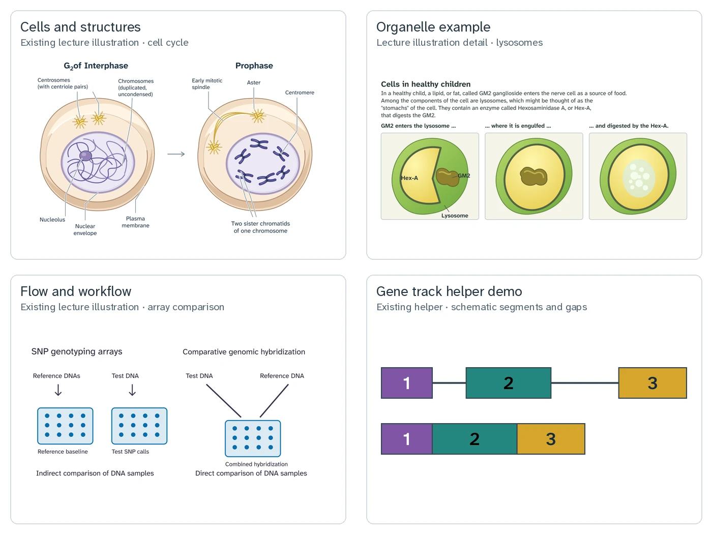

# Reusable SVG drawing-tool roadmap

This roadmap identifies reusable **drawing parts** after a repository-wide SVG inventory and
checks for existing coverage in nearby projects. It recommends cells and cell structures first,
basic flowchart parts second, and extensions to existing gene tracks third. It does not implement
new tools, specify an API, or change slides or source illustrations.

The overview shows existing material, not output from proposed tools. Reading left to right,
top to bottom:

1. [Mitosis: interphase and prophase](../genetics/LECT06/djot/assets/lect06b-intro_cells/mitosis_interphase_prophase.drawn.svg), whole source.
2. [Tay-Sachs lysosome comparison](../genetics/LECT14/djot/assets/lect14c-hardy_weinberg_1/tay_sachs_lysosome_comparison.drawn.svg), detail cropped from rendered coordinates (0, 0) to (1200, 560); the source remains whole.
3. [Array comparison workflow](../genetics/LECT11/djot/assets/lect11d-chromo_alter_1-deletions/array_comparison_workflow.drawn.svg), whole source.
4. Existing [gene-track helper](../svg_tools/gene_tracks.py) demonstration: segments
   `('1', '#8056A5', 60)`, `('2', '#25877F', 100)`, `('3', '#D6A62E', 80)`;
   separated introns `(40, 80)`, width 600, height 60; joined introns `(0, 0)`, width 400,
   height 60. Exon widths remain the same. This is not an operon demonstration.

The first three figures are referenced by
[lect06b-intro_cells.djot](../genetics/LECT06/djot/lect06b-intro_cells.djot),
[lect14c_hardy_weinberg_1_part_01.djot](../genetics/LECT14/djot/lect14c_hardy_weinberg_1_part_01.djot),
and [lect11d_deletion_mechanisms.djot](../genetics/LECT11/djot/lect11d_deletion_mechanisms.djot),
respectively. The overview is an index; fine print in the full figures may not be readable there.

## Inventory: what exists

The [filterable inventory](active_plans/reports/svg_inventory_2026_11_13.csv) records every
SVG path found on 2026-11-13, including coursework, documentation, archives, development,
temporary files, and Biotechnology LECT11. Inclusion does not change ownership or permission to
edit a file. It contains 1,039 paths, 1,011 unique content hashes, and 28 duplicate paths in
25 hash groups. Counts in each category are paths and distinct hashes within that category;
hashes can occur in more than one scope. There are 882 vector, 126 mixed, and 31 raster-wrapper
paths; 157 paths contain embedded images. A wrapper is catalogued but is not necessarily
editable vector artwork.

Categories describe subject matter, not priority, artistic acceptance, rights, or live use.
The table summarizes recurring subject or visual parts; consult the CSV for individual paths,
confirmed object tags, and review basis. Archived and temporary examples are historical
references, while a literal Djot or Markdown `source_consumers` reference alone does not prove
a current compiled slide uses the asset.

| Inventory category | Paths | Unique hashes | Recurring parts and coverage or opportunity |
| --- | ---: | ---: | --- |
| Administrative and branding icons | 3 | 3 | Labels and symbols; use existing assets. |
| Biochemistry and molecular structure | 34 | 32 | Molecules, antibodies, membranes and enzymes; BPQ covers several motifs; antibody parts merit later examination. |
| Cell structure and division | 49 | 49 | Cells, nuclei and division; fixed figures suggest reusable cell parts. |
| Chromosome and cytogenetics | 249 | 245 | Chromosomes, chromatids, bands and intervals; local chromosome helper covers much of the geometry. |
| DNA, RNA and gene structure | 43 | 41 | Gene tracks, exons, introns and constructs; extend the local track helper. |
| Gene mapping and recombination | 135 | 135 | Maps, recombination, asci and tetrads; existing mapping and tetrad work supplies related parts. |
| Genetic cross and probability | 87 | 85 | Punnett squares, allele tokens and branching; BPQ already covers crosses; general flow parts are separate. |
| Inheritance and pedigree | 38 | 38 | Pedigree symbols and relationships; BPQ pedigree layout and SVG output already exist. |
| Instructional text and annotation | 80 | 71 | Text, boxes, arrows and workflow nodes; simple composable flow parts may help. |
| Laboratory methods and equipment | 67 | 65 | Wells, apparatus, samples and workflows; Virtual Lab supplies labware artwork and BPQ covers gels. |
| Organism and phenotype | 22 | 21 | Plants, animals and phenotype details; BPQ has phenotype artwork; selected plant parts may merit later work. |
| Phylogenetics and trees | 103 | 103 | Branching trees and labels; BPQ has phylogenetic tree rendering. |
| Population genetics and evolution | 79 | 75 | Alleles, organism and population tokens, plots; selected tokens may merit later examination. |
| Statistics and data visualization | 50 | 48 | Tables, graphs, distributions and comparisons; existing BPQ statistics renderers cover related needs. |

The content audit used four partitions and assigned each path a review basis: 85 visual renders,
427 XML geometry and text reviews, and 527 source-context classifications. The last is not a
visual review. The CSV has zero parse errors and no unresolved category labels, but that does
not mean every label or artwork has received visual acceptance. Confirmed visible-object tags
appear on 418 paths: these are lower bounds from the reviewed subset, not complete object
counts. Keyword mentions are separate and must not be counted as visible objects. Duplicate
classifications or tags may inherit evidence from identical content, without implying that every
copy was rendered. Five blank imports noted during review are converter artifacts, not evidence
for a new tool. No repair is proposed here.

## Recommended drawing parts

### 1. Cells and cell structures

Start with a cell outline, nucleus and nucleolus, and selected organelle glyphs grounded in real
teaching illustrations. The mitosis and lysosome sources above show different combinations of
cells, nuclei and subcellular structures. Let the authored recipe choose the parts, sizes,
positions and labels. Preserve the particular structure being taught; the goal is useful
schematic components, not a biological simulation or a generic engine for every anatomy.
Compare rendered results to the source examples at slide size before expanding the vocabulary.

### 2. Basic flowchart parts

The array comparison above and other catalogued workflows show boxes, arrows and branches.
Start with explicitly placed process boxes, decision shapes, arrows and branch labels. Authors
supply the placement and scientific relationships. Automatic graph layout is not promised.
Do not import an entire slide converter or browser scene engine to draw a few parts.

### 3. Extend DNA gene tracks

[gene_tracks.py](../svg_tools/gene_tracks.py) already provides exon blocks and intron spans,
including zero gaps, with width, height and returned exon offsets. Extend this existing helper
rather than create a parallel DNA tool. Future oriented features, promoter and operator
landmarks, and composition of an operon from supplied parts address the unmet teaching target.
Biological order, direction and labels remain in the recipe. The archive includes an
[enhancer/promoter illustration](archive/genetics_gene_tree_svg/artwork/phy_e_enhancer_losses.drawn.svg),
which is historical artwork, not a current tool. No native operon component was confirmed in
the inspected sources; validate a future extension against a concrete teaching example.

### Later candidates

The inventory includes antibodies, flowers, seeds, population tokens and molecular assemblies.
Examine small reusable parts only after the three priorities, and first check the existing
coverage below. These are observations to investigate, not commitments to build complete
scene engines. Coverage in another format still counts as coverage; an SVG adapter alone is
not a new subject gap.

## Reuse before building

Local [chromosomes.py](../svg_tools/chromosomes.py), [gene_tracks.py](../svg_tools/gene_tracks.py),
and `project`, `cuboid`, and `cylinder` in [drawing.py](../svg_tools/drawing.py) provide existing
building blocks. [render_tetrad_tables.py](../slide_lib/render_tetrad_tables.py) already reuses
BPQ tetrad work. Paths below are relative to the `biology-problems` repository (BPQ).

| Subject | Existing BPQ work |
| --- | --- |
| Pedigrees | `problems/inheritance-problems/pedigrees/pedigree_lib/svg_output.py` and `layout.py`: SVG and layout. |
| Gels | `problems/dna_profiling-problems/gellib.py`: HTML and Pillow. |
| Punnett squares | `problems/inheritance-problems/punnett_choice.py`. |
| Restriction maps | `problems/molecular_biology-problems/restriction_enzymes/dna_render_lib.py`. |
| Tetrads and asci | `problems/inheritance-problems/gene_mapping/genemap_art/asci.py`. |
| Trees and phenotype | `problems/inheritance-problems/phylogenetic_trees/treelib/` and `problems/inheritance-problems/gene_mapping/genemap_art/phenotype_art.py`. |
| Membranes | `problems/biochemistry-problems/membranes/` PGML and SVG motifs; `tools/sync_membrane_svgs.py`. |
| Enzyme simulation | `problems/biochemistry-problems/enzymes/enzyme_simulation.pgml`: canvas illustrations. |
| Sequences and chemical structures | `problems/molecular_biology-problems/seqlib.py` and `problems/biochemistry-problems/PUBCHEM/`: sequence HTML and chemical depiction. |
| Statistics | `problems/biostatistics-problems/` boxplots, `problems/chi_square/` HTML, and enzyme plots using PG graphing. |

The separate `virtual-lab-protocol-simulation` repository has equipment artwork under
`assets/equipment/{static,binary_state,multi_state,variable_volume}/`, including tubes,
pipettes, plates, racks, microscope, centrifuge, incubator, flasks and electrophoresis equipment.
Reuse suitable asset geometry or artwork, not the whole Solid browser runtime in
`src/scene_runtime/renderer/`. Check `assets/equipment/SOURCES.md` and
`docs/THIRD_PARTY_ASSETS.md` there for each asset's provenance and attribution; sources include
CC BY 3.0, CC BY 4.0, CC0 and repository-authored work. Its cell observation panels are not a
general organelle library. No flowchart, exon/intron/operon or general organelle counterpart was
found in the inspected Virtual Lab source; unlabelled static assets were not exhaustively reviewed.
These cross-repository references do not add runtime dependencies.

## Design and review boundaries

Keep SVG fragments editable and compose them in authored recipes. Titles and captions stay native
in Djot; figure-specific scientific relationships and labels remain the author's responsibility.
Reference illustrations may retain legacy fonts. For future normal text use Atkinson Hyperlegible
Next, and use the Mono role for aligned sequences as needed. The current `drawing.text` Arial
default is a future fix, not a change here. Follow [COLOR_GUIDE.md](slide-specs/COLOR_GUIDE.md):
keep semantic color meanings stable independently of course hue. No theme framework is proposed.
Review future output at its intended slide size; this inventory is not classroom, license, or
complete visual-quality validation.
