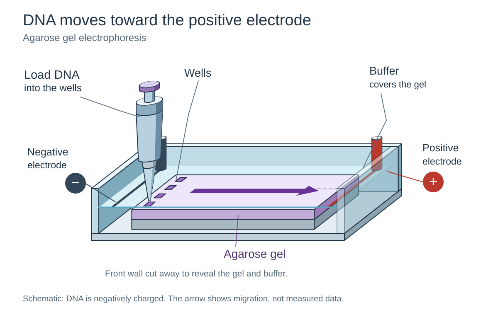
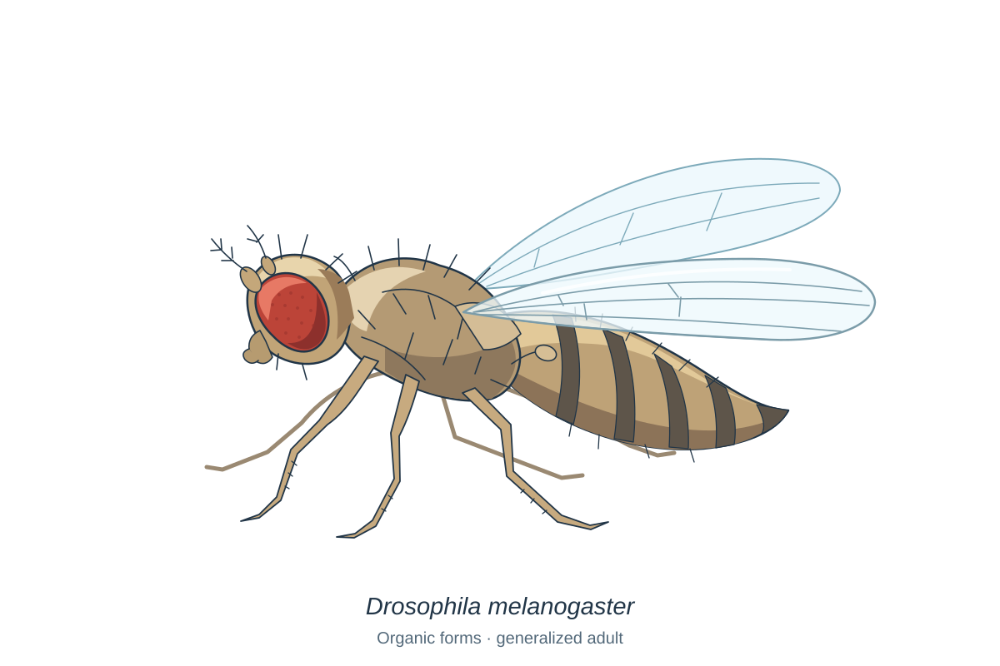
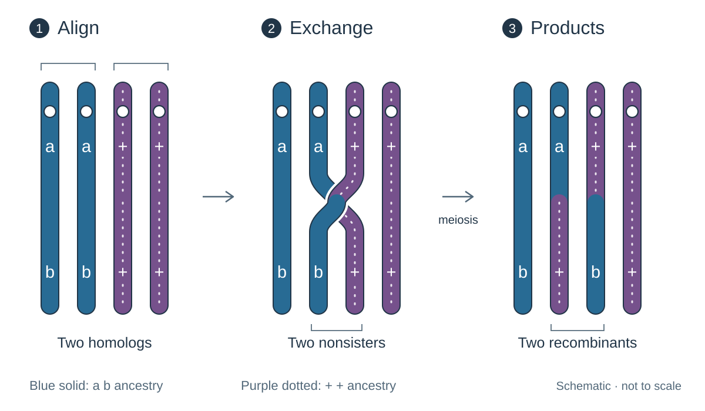

# Genetics illustration guide

**PROVISIONAL.** Use these reviewed prototypes to make original, recognizable artwork that
helps students see a subject or follow a relationship. They demonstrate a shared language,
with room for each subject's anatomy, geometry and teaching purpose. They are examples for
further review, not final lecture integration or a fixed style specification.

Follow [COLOR_GUIDE.md](COLOR_GUIDE.md), [PEDAGOGY_GUIDE.md](PEDAGOGY_GUIDE.md) and
[SVG_DIAGRAMS.md](SVG_DIAGRAMS.md). Current instructor direction takes precedence. The
[genetics_illustration_reassessment.md](../active_plans/reports/genetics_illustration_reassessment.md)
records the renewal's scope and source-preservation boundaries.

## Three working examples

### Equipment: show connected parts

[gel_apparatus.drawn.svg](illustration_examples/gel_apparatus.drawn.svg) uses projected boxes
and cylinders to connect the wells, submerged gel and opposed electrodes in one space. Light
top faces and darker side faces explain volume. The named front cutaway exposes the process;
the arrow shows DNA migration, not measured bands. Four wells and apparatus proportions are
illustrative. Source context: Genetics LECT02F, electrophoresis.

### Organism: build a silhouette

[drosophila_organic.drawn.svg](illustration_examples/drosophila_organic.drawn.svg) joins curved
head, thorax and abdomen masses, then adds overlapping wings and articulated appendages.
Natural tan/brown values and the red eye aid recognition. A few bristles, abdominal bands and
wing veins suggest anatomy without letting texture dominate. Source context: Genetics LECT08B,
Drosophila trait comparisons; this example depicts a generalized normal adult.

**Use limit:** the far hind leg is heavily hidden by the abdomen. Six leg groups in the SVG
do not make six legs visibly countable. Use this pose for organism recognition or phenotype
illustration; choose a clearer pose for a leg-counting lesson. It is not a diagnostic species
or sex plate, and its proportions are unmeasured. A simpler silhouette can work better when
many flies share a comparison panel.

### Diagram: expose the relationship

[crossover_three_stage.drawn.svg](illustration_examples/crossover_three_stage.drawn.svg) stays
flat so students can trace ancestry. Blue solid and purple dotted chromatids, live allele
labels and open space make the two unchanged and two reciprocal products explicit. The inner
nonsisters exchange between `a` and `b`; products are ordered by proximal ancestry. The short
white interruption clarifies overlap, not a molecular junction mechanism. Source context:
Genetics LECT08B original ODP, slide 32, with `a b / + +` alleles retained.

## Canonical equipment examples

These Biotechnology drawings pass actual-source ODP/PDF contextual review. Use
[image_037.drawn.svg](../../biotech/LECT04/djot/assets/lect04c-talking_points_set_3/image_037.drawn.svg)
to study connected instruments: shared cuboid/cylinder construction supports a continuous solid
fluid path, while a dotted detector-to-computer path identifies data. Use
[insulin_stage_3.drawn.svg](../../biotech/LECT04/djot/assets/lect04c-talking_points_set_3/insulin_stage_3.drawn.svg)
to study a curved cell silhouette and a cutaway production tank whose identity carries across
the sequence. Keep the teaching relationship visible when reducing either drawing; inherited
small panels need the larger figure pages or zoom for fine labels. Current canonical build
status remains in the progress ledger below.

## Historical human compatibility example

[human_life_cycle.drawn.svg](../../genetics/LECT06/djot/assets/lect06c-meiosis/human_life_cycle.drawn.svg)
connects recognizable adult silhouettes to separate gonad details and gamete branches, then
joins fertilization and the diploid return. Clear contours and route spacing carry the cycle.
Actual-source ODP/PDF review found skin banding absent from the standalone preview; replacing
four skin fills with existing palette solids removed it while preserving all other artwork
bytes. This retained historical example records a scoped compatibility fix, not a general
gradient restriction or a current drawing assignment. New human-figure drawing is deferred;
the earlier integration and review evidence remains in the progress ledger.

## Canonical cell example

[meiosis_prophase_metaphase_i.drawn.svg](../../genetics/LECT06/djot/assets/lect06c-meiosis/meiosis_prophase_metaphase_i.drawn.svg)
combines curved cell outlines and restrained shading for volume with flat, traceable chromatids.
Cell depth supports recognition while chromosome ancestry and pairings remain the teaching
focus. Fine anatomy labels need the large lecture view. This example passes actual-source
contextual and canonical ODP/PDF review; delivery evidence remains in the progress ledger.

[colchicine_chromosome_doubling.drawn.svg](../../genetics/LECT11/djot/assets/lect11b-polyploidy/colchicine_chromosome_doubling.drawn.svg)
uses four rounded cells and two clear branches to compare three replicated chromosomes with
3 + 3 untreated singles and six treated singles. Joined sisters in the parent and separate
single chromosomes in the outcomes make counts visible. Color, length and shape preserve
chromosome identity. All five live source labels remain readable in the actual slide.
The pure-vector drawing passes canonical ODP/PDF contextual review.

## Cutaway compartments

[liposome_structure.drawn.svg](../../biotech/LECT10/djot/assets/set5_gene_therapy/liposome_structure.drawn.svg)
opens a dimensional shell to separate aqueous cargo, bilayer-localized drug and exterior
chains. Paired lipid heads and tails explain the boundary; leaders end within the compartment
or on the structure they name. The silhouette carries the half-width view while the preserved
adjacent big-image slide supplies readable fine labels and bilayer detail. Both actual-source
placements pass contextual review; canonical full-root delivery status remains in the progress
ledger. Use this composition for this source's compartments, not as a universal delivery model.

## Withdrawn prenatal composition example

[amniocentesis.drawn.svg](../../genetics/LECT10/djot/assets/lect10_repaired_figures/amniocentesis.drawn.svg)
is **WITHDRAWN** following the instructor's rejection; prenatal drawing is **DEFERRED**.
The earlier placement/font-fit review remains historical evidence and does not establish
acceptable artwork. Use the original labeled raster fallback for lecture continuity, and
consult [SVG_REPAIR_BACKLOG.md](../SVG_REPAIR_BACKLOG.md) for the controlling decision.

## Organic cycles with evidence

[neurospora_life_cycle.drawn.svg](../../genetics/LECT09/djot/assets/lect09b-tetrads_1_introduction/neurospora_life_cycle.drawn.svg)
uses connected branching hyphae, conidial chains and curved germ tubes to distinguish two
mating identities. Open space separates vegetative loops from the nuclear-division sequence.
The placed
[neurospora_life_cycle.svg](../../genetics/LECT09/djot/assets/lect09b-tetrads_1_introduction/neurospora_life_cycle.svg)
combines this editable drawing with the exact retained empirical photograph, following
[SVG_DIAGRAMS.md](SVG_DIAGRAMS.md). Actual-source ODP/PDF review accepts the complete view.
SVG/ODP retains the source photo pixels; normal PDF export reduces its fine detail, so detailed
observation uses the retained source, SVG or ODP. Keep loop captions clear of route curves;
this example's lower captions remain readable despite close arcs. Canonical full-root delivery
status remains in the progress ledger.

## Wide inheritance comparisons

[morgan_cross_chromosomes.drawn.svg](../../genetics/LECT06/djot/assets/lect06d-x_linked_genes_1/morgan_cross_chromosomes.drawn.svg)
spreads the parental, gamete and offspring groups across a wide slide. Connected fly heads
carry phenotype and sex, while separate chromosome routes preserve ancestry and allele
relationships. Open space lets students follow the branches without crossing labels.
Actual-source ODP/PDF review accepts the composition; fine allele marks need the full lecture
view. Canonical full-root delivery status remains in the progress ledger.

## Connected industrial cutaways

[cellulosic_ethanol.drawn.svg](../../biotech/LECT06/djot/assets/lect06c-set_4_tp_chapter_12_16_material/cellulosic_ethanol.drawn.svg)
connects feed equipment, reactors and distillation into one process scene. Cutaway windows
show enzyme action and microbial fermentation within recognizable vessels, so the biological
steps remain tied to the equipment. Complete stage sentences and direct labels preserve the
source explanation. Actual-source ODP/PDF review accepts the composition; fine captions need
the full lecture view. Canonical full-root delivery status remains in the progress ledger.

## Scale within a cutaway

[plant_primary_wall.drawn.svg](../../biotech/LECT06/djot/assets/lect06c-set_4_tp_chapter_12_16_material/plant_primary_wall.drawn.svg)
uses an oblique cutaway to separate wall regions while showing crossed cellulose rods, pectin
and glycans that contact their surfaces. The independent 50 nm bar preserves the source-relative
fibril scale; separate layer brackets describe schematic exploded spacing, not measured wall
thickness. Leaders reach the named materials. Actual-source ODP/PDF review accepts the drawing
and its complete figure credit; fine strands and neighboring chemistry need the large view.
Canonical full-root delivery status remains in the progress ledger.

## Botanical stage construction

[strawberry_polyploid.drawn.svg](../../genetics/LECT11/djot/assets/lect11b-polyploidy/strawberry_polyploid.drawn.svg)
uses organic plant, root and fruit contours with a glass culture vessel to explain the source
stage process. Open branch/merge routes retain the two `2n` circles, A-D stages and fruit
comparison without letting surface detail compete with their relationships. Source labels
remain live and unchanged. Actual-source ODP/PDF review accepts the composition; canonical
full-root delivery status remains in the progress ledger.

[pea_mendel_p.drawn.svg](../../genetics/LECT05/djot/assets/lect05h-epistasis/pea_mendel_p.drawn.svg)
builds each pea flower from a standard, paired wings and a cupped keel, while
[four_oclock_incomplete_cross.drawn.svg](../../genetics/LECT05/djot/assets/lect05f-degrees_of_dominance/four_oclock_incomplete_cross.drawn.svg)
uses a continuous funnel. Related line weights and restrained shading keep the drawings
coherent while their different silhouettes preserve botanical identity. Both pass actual-source
ODP/PDF contextual review; canonical delivery status remains in the progress ledger.

## Chromosome language: straight single chromatids

The [editable specimen](illustration_examples/chromosome_language.drawn.svg) establishes
a native-SVG adaptation of the BPQ chromosome visual vocabulary. Use the small
[chromosome helper and recipe](../../svg_tools/README.md#single-chromatid-chromosomes)
for repeated straight rods: one continuous outlined silhouette with rounded neutral
ends, ordered colored regions, a pale outlined centromere collar, and explicit white
zigzag joins. The collar narrows the silhouette slightly while remaining attached
to both arms. It is never a floating dot or an exchange seam.

- Gene letters carry order and identity; colored regions carry the source's emphasis
  or segment ancestry. Carry colors with exchanged segments. Keep the same region
  pitch across a comparison so deletion shortens and duplication lengthens the rod.
- The two terminal caps are illustrative end treatments, not labeled regions or
  extra genes. A collar represents a source-established centromere locus. Omitting
  the collar is explicit, never an inferred claim about an unknown centromere.
- White zigzags mark explicitly authored joins. Red cut pointers belong at actual
  source break boundaries, using the helper's returned coordinates. They are not
  centromeres. Source captions and slide titles remain native Djot.
- Restrained irregular banding suggests chromosome material; it is decorative,
  never a measured G-band pattern. Equal letter spacing is also schematic.
- Use flat live Atkinson Hyperlegible Next labels. Judge gene order, contrast and
  collar/join distinction at the actual smallest image placement, not just enlarged art.
- For source alleles such as `a+` and `b-`, opt in to the helper's `allele_labels=True`:
  live italic lowercase letters and raised plus/minus signs preserve genotype identity
  independently of hue. Empty regions can depict an unlabeled arm before a centromere;
  they are not genes. Separate homolog rods remain separate, never joined as sisters.

The recipe's four LECT11 overview candidates preserve deletion `ABCDE|FGH -> ABCE|FGH`,
duplication `ABCDE|FGH -> ABCBCDE|FGH`, inversion `ABCDE|FGH -> ADCBE|FGH`, and reciprocal
translocation `ABCDE|FGH + MNOPQ|R -> MNOCDE|FGH + ABPQ|R`; `|` denotes the centromere.
Each uses single chromatids and depicts no discarded fragments. These are a bounded
pilot, not evidence that every LECT11 chromosome family has been migrated.

The reusable model API in [README.md](../../svg_tools/README.md#chromosome-drawing-tool)
adds requested colors and sizes, variable segment lengths, rounded-X identical sisters,
portrait orientation and a hollow purple centromere marker over a short neck. The oval
is a diagram convention, not swollen chromosome material. Short internal marker text remains
available; returned segment anchors and marker bounds support external annotations while
text stays upright. The legacy narrow collar remains pale and filled. Keep one common
length scale across internal deletions and reciprocal right-tail exchanges so shortening
stays visible. These bounded operations are not a general rearrangement simulator.

The current [chromosome_tool_v2.drawn.svg](illustration_examples/chromosome_tool_v2.drawn.svg)
is generated by `make_tool_v2_specimen(path)` in
[chromosome_examples.py](../../svg_tools/chromosome_examples.py). Its single and rounded-X
sister forms use the same 44-band chr7 model, 520-unit longitudinal scale, 64-unit
per-chromatid width, source boundaries, rounded ends and hollow 100-by-38 centromere marker.
Vector brackets preserve the nested q/q3/q31/q31.2 hierarchy. A linked q31 detail reuses
the whole map at fivefold isotropic scale with flat internal cut ends, so it does not imply
new chromosome termini. CFTR is labeled `7q31.2`; these are approximate cytoband intervals,
not precise molecular coordinates. `17q41.3` remains a schematic address exercise, not a real chromosome
17 map. Source addresses and stain fills follow segment identity through rearrangements.
Decorative texture and dense internal labels can be hidden without removing actual band fills.
Decorative band modes and caller colors need not copy the source stain palette; shared geometry
and outline give the family its visual connection.
See [chr7_hg38_cytobands.provenance.json](../../svg_tools/data/chr7_hg38_cytobands.provenance.json)
for the source URL, retrieval date and checksum. In dense source-backed maps, place the
centromere label outside, attached to a `marker_bounds` edge midpoint. Include stroke when
checking clearance against neighboring segment endpoints. The README's separate 700-by-100
API example uses a thin hollow `marker_size=(18, 100)` with `marker_label=None`; the revised
specimen uses the broad hollow marker in both whole forms. Both source `acen` bands remain
exposed around its collar gap, although their narrow intervals are subtle at reduced size.
Marker and collar space are not genomic length.

The chromosome 1-3 recipe in [README.md](../../svg_tools/README.md#chromosome-drawing-tool)
uses three source TSVs and portable provenance to render 187 intervals at one genomic scale.
Its 46 band labels, 16 region numbers, six arm labels and three groups are teaching selections;
caps and centromeres are schematic, and physical arm ratios are not exact. The documented
command regenerates the figure to a scratch path.

The saved [chromosome_tool.drawn.svg](illustration_examples/chromosome_tool.drawn.svg) and
its closure.md (`_temp/chromosome_svg_tool/closure.md`; scratch evidence removed 2026-11-13) record historical v1 review.
The user rejected that sister shape; the rounded-X renderer supersedes that acceptance.
The rejection remains in [SVG_REPAIR_BACKLOG.md](../SVG_REPAIR_BACKLOG.md). Historical
1150-pixel sister and 480-pixel overview proofs establish no v2 minimum placement size. Historical
recipe functions use today's renderer when called; saved v1 art remains historical evidence.
Separate exon/intron tracks still connect thick exons with thin positive intron spans;
zero spans join exons without chromosome caps, collars or bands.

Demonstrated revised proof sizes are 1600 x 860 and 1000 x 538 for the gallery, 775 x 535 for
the whole forms and 530 x 385 for q31 detail. A 1800 x 270 centromere diagnostic magnifies
the narrow `acen` rows; it is not a minimum readable placement. These proofs are not universal
minima. The user rejected the previous v2 gallery's inconsistent theme; the revised specimen
follows the root-approved shared-family direction. Fresh specification, quality and integration
reviews PASS; root viewed all five final production proofs. The standalone shared-theme
revision is DONE. With `PANGOCAIRO_BACKEND=fc`, the rendered font diagnostic matched
installed Atkinson Hyperlegible Next glyph operations and advances. Inspect text at the intended
placement; label fitting is approximate and a family declaration alone does not establish
font selection.
The rendering command is in [README.md](../../svg_tools/README.md#chromosome-drawing-tool).
No instructor, classroom, print or native slide/export acceptance is established.

Curved pairing and crossover forms, ploidy-count scenes, sex-chromosome pairing and other
source-specific maps still require their own checks and construction. The new specimen
makes no course restoration or migration claim; actual course integration and export
evidence belong to the progress ledger.

## Pedigrees: reuse the BPQ native SVG renderer

Author pedigree figures through biology-problems (BPQ), under
`problems/inheritance-problems/pedigrees/`: `pedigree_lib.family` supplies `Person`,
`Union`, `Observation` and `Family`; `pedigree_lib.svg_output.render_svg` emits
editable circles, squares, lines and live text. Use stable person IDs, explicit
parent/child lists and observed fills; validate the family and observations before
rendering. Parent roles do not determine the left/right order of drawn spouses.

For source-faithful slides, construct `layout.Symbol`, `Segment` and `Diagram`
objects with fixed coordinates and explicit union membership. Automatic `lay_out`
is optional: it may rearrange source order or require centered offspring. Keep
`render_svg`'s geometry validation enabled; resolve a rejected layout before
styling. The current family model supports one union per person and unique
parentage, and rejects inconsistent generations. Do not silently simplify a source
that exceeds these limits or build a second pedigree renderer in this project.

The renderer currently uses 30-unit symbols and fixed label styling. Apply a
consistent coordinate scale, then adapt the returned SVG's live text to installed
Atkinson Hyperlegible Next, the source palette and readable placement-specific
sizes. Preserve symbol shapes, spouse order, child order and all connections,
including offset stems and deliberately unconnected nearby symbols. Add neutral
accessible metadata and row labels where the source includes them; add no inferred
genotypes, inheritance answer or carrier marks. Check the smallest actual frame
for every label, connector, symbol boundary and margin.

Use BPQ during authoring only. Keep the final `.drawn.svg` static and self-contained;
course builds do not import BPQ. Record the authoring call, BPQ source hashes,
source/graph checks and rendered proofs in task evidence so reuse is reproducible.

## Shared drawing choices

| Choice | Apply it to the subject |
| --- | --- |
| Ink and line hierarchy | Start with dark blue-gray `#213547` contours and `#526879` supporting text. Make essential boundaries stronger than leaders, internal marks and distant parts. These are example values, not a replacement course palette. |
| Selective detail | Establish silhouette, major masses and negative spaces first. Add detail that explains identity or the task. A small bristle or facet may disappear at reduced size without losing the subject. |
| Meaningful color | Preserve course and biological identities through related views. Pair color with labels, signs, shapes, dots or position. Natural fly colors and chromatid ancestry colors serve different purposes; no universal hue assignment follows from these examples. |
| Projection and light | Keep depth edges and circular planes consistent within an object. Where shading helps, two or three values and a common upper-left light usually suffice. Use flat geometry when topology or comparison carries the lesson; 3D is optional. |
| Labels and space | Keep short labels live and close to their referents, with leaders ending on the intended part. Use readable sans-serif text and room around labels. Keep slide titles, explanations and captions in native Djot. |

On these 1200-unit-wide examples, roughly 2-3 units work for many outlines and 1.3-1.8 for
supporting lines. Equipment annotations are about 22-29 units; crossover headings are larger.
These are starting proportions, not global constants: a chromosome's broad colored stroke is
the object itself, and a fly leg needs more weight than a vein. Judge the rendered hierarchy.

## Preserve the science

Compose original artwork from source facts and observation. Change viewpoint, spacing and
illustrative contours when that improves recognition or explanation; do not trace pixels.
Retain identities, chemical bonds, data-defined counts, allele relationships, measured values,
course examples and question/reveal states. Keep empirical photographs and experimental images
as evidence; do not invent cleaner bands, points or results. Mark schematic or unmeasured views
and resolve uncertain source meaning before labeling a new reconstruction.

Use the smallest useful construction vocabulary. The apparatus demonstrates shared cuboid and
cylinder/taper geometry. Its cutaway, well placement and label targets remain subject-specific.
The fly's curves do not by themselves justify a general organism constructor. Share a part when
real drawings need the same operation; keep biological assembly and scientific topology local.

## Editable source and review

- The active goal delivers pure vector SVG, with no `<image>` elements or embedded bitmaps.
  Quality-90 WebP previews and retained raster fallbacks are not completed SVG deliverables.
- Keep original vector art in self-contained `.drawn.svg` files with a stable positive `viewBox`,
  meaningful groups and unique IDs. Reuse small parts only where it makes editing clearer.
- Preserve live text, a useful `title` and `desc`, and host image alt text. The SVG is the editable
  artwork; Impress embeds it as one image object. No linked fonts, scripts or raster wrappers
  belong in these original-drawing examples. Use the installed Atkinson Hyperlegible Next and
  Mono font roles by family name, without per-SVG font embedding; follow
  [SVG_DIAGRAMS.md](SVG_DIAGRAMS.md).
- Keep source ASCII. Use numeric XML character references such as `&#8722;` for a minus sign;
  HTML-only names such as `&alpha;` are not valid standalone SVG entities.
  ASCII source bytes are compatible with an `encoding="UTF-8"` XML declaration. In the fuel-cell
  drawings, `encoding="ASCII"` caused blank LibreOffice import; changing only that declaration
  to UTF-8 restored both drawings and their selectable labels without changing parsed artwork.
- Parse XML and resolve references, then inspect one direct preview at intended display size.
  Brief artist and manager review checks labels, boundaries, color meaning and taught relationships
  before image-URL integration. Use the known image frame when available.
- Add extra sizes, independent review or a targeted consumer/export check for a concrete concern,
  such as a known LibreOffice SVG failure, crop, overlay, reveal or uncertain image frame.
  Ordinary art milestones complete through the brief review and integration; external human
  feedback is optional.
- In scratch Djot proofs, use supported repository-relative image URLs such as
  `repo:_temp/art_proof/example.drawn.svg`. Absolute paths and `../` traversal can parse but
  fail the builder's image-path checks; reuse `repo:` for artwork elsewhere in the checkout.

## Evidence and current limits

The three illustrations are durable copies of independently reviewed scratch prototypes.
Non-ASCII characters are encoded as numeric XML references without changing parsed SVG content.
The earlier seven-page scratch proof and its visual review support the demonstrated collection
fit; they do not establish final lecture placement, attended playback or learner acceptance.
Current task status belongs to
[genetics_visual_renewal_progress.md](../active_plans/reports/genetics_visual_renewal_progress.md).

Historical scratch evidence removed 2026-11-13 was recorded under:
`_temp/svg_construction_primitives/findings.md`,
`_temp/svg_visual_language/organism/REVIEW.md`,
`_temp/svg_visual_language/diagram/NOTES.md`,
`_temp/svg_visual_language/VISUAL_REVIEW.md`, and
`_temp/svg_visual_language/export/evidence.json` with `visual_language_proof.pdf`.
Those records contained construction passages, source checks and the seven-page export receipt.
The [durable renewal report](../ILLUSTRATION_RENEWAL_REPORT.md) supersedes their summary.
The durable examples and guidance above remain usable without those local files.
