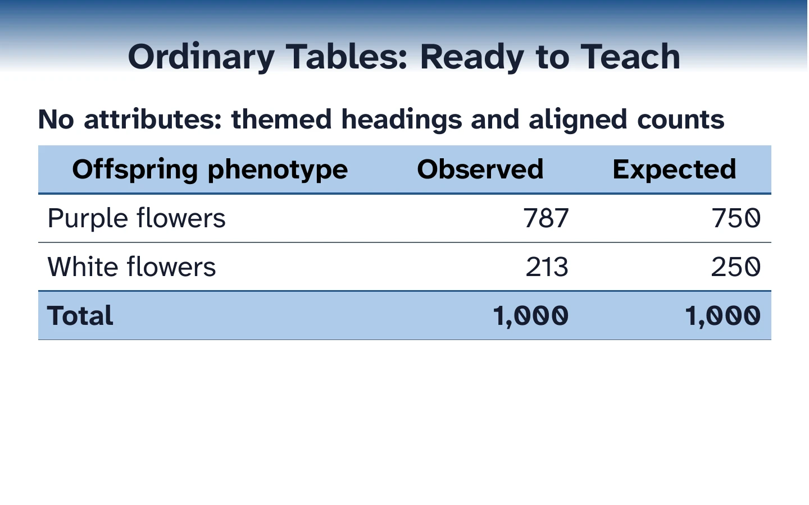
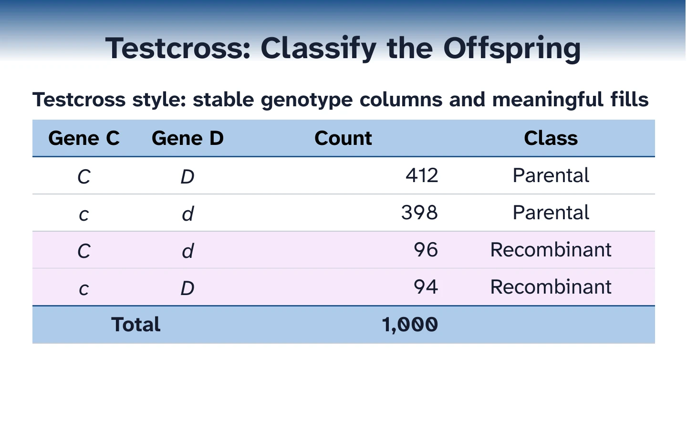
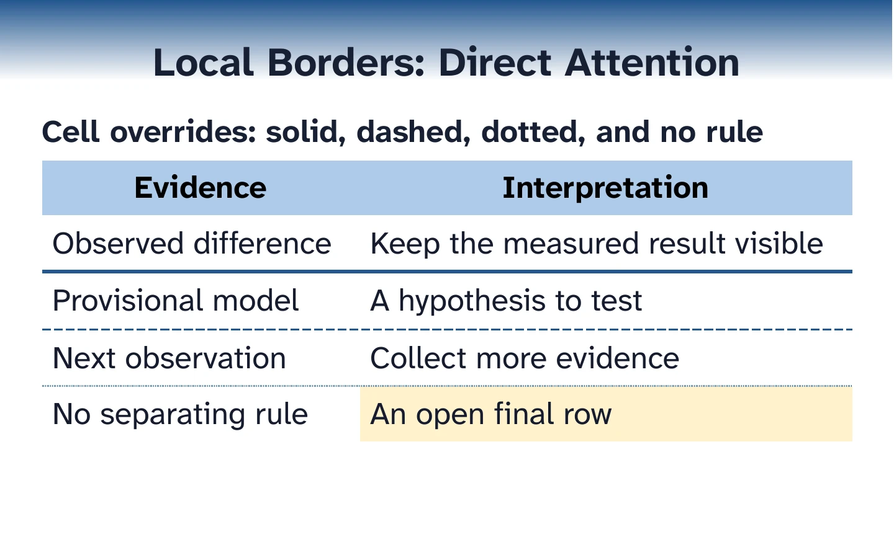

# Native table authoring

Write an ordinary pipe table first. The builder supplies course-colored headings, comfortable
spacing, numeric alignment, and a distinct total row. Keep the table's labels, units, and
scientific notation in the source.

```djot
| Offspring phenotype | Observed | Expected |
| --- | --- | --- |
| Purple flowers | 787 | 750 |
| White flowers | 213 | 250 |
| Total | 1,000 | 1,000 |
```

For a maintained demonstration of every preset and the local formatting tools, build
[../../examples/table_styles.djot](../../examples/table_styles.djot):

```bash
source source_me.sh && python3 deck_tools.py build examples/table_styles.djot --format all
```

Run this command from the repository root, outside an agent sandbox on this macOS host. It writes
`output/odp/table_styles.odp` and `output/pdf/table_styles.pdf`. The ODP contains native editable
tables. The PDF is the distribution copy. Edit Djot and rebuild to retain changes in future builds;
Impress edits do not flow back into Djot.



## Choose native tables or artwork

Use native pipe tables for ordinary data, calculations, and comparisons that should stay editable
in Impress. Keep image-rich tables and diagram-like compositions as SVG artwork when pictures and
spatial design carry the teaching point. See [SVG_DIAGRAMS.md](SVG_DIAGRAMS.md) for that workflow;
SVG artwork is outside the native table styling system.

## Choose a teaching treatment

Add one attribute immediately before a table when its teaching job benefits from a preset:

```djot
{table-style=working}
| Offspring | Observed | Expected |
| --- | --- | --- |
| Purple | 787 | 750 |
| White | 213 | 250 |
| Total | 1,000 | 1,000 |
```

| Preset | Useful for | Visual treatment |
| --- | --- | --- |
| `standard` | Ordinary data and summaries | Light course-colored header, open horizontal rules, emphasized total |
| `comparison` | Parallel explanations | More breathing room and open horizontal rules |
| `working` | Calculations and repeated workspaces | Ruled grid and emphasized total |
| `testcross` | Genotype columns, counts, and classifications | Centered symbols, aligned numeric counts, open row rules |
| `punnett` | Gamete axes and genotype outcomes | Shaded top/left headings and centered grid |
| `matrix-lower` | Pairwise values below the diagonal | Shaded axes and diagonal; quiet unused triangle |
| `matrix-upper` | Pairwise values above the diagonal | Shaded axes and diagonal; quiet unused triangle |

Omitting `table-style` selects `standard`. Course decoration follows the deck's `color-theme`.
Explicit scientific fills remain the same across course themes. Preserve labels alongside color;
a color alone should not carry a classification or answer.



Compare the same rendered table in Genetics, Biotechnology, and Biostatistics in
[../screenshots/table_theme_comparison.webp](../screenshots/table_theme_comparison.webp).

## Keep a workspace stable

Give related question and answer tables the same `table-group`. The builder measures the full
sequence before fitting either state, so revealing a longer answer does not move the columns.
The group requires the same number of columns; it does not force equal row heights.

```djot
{table-style=working table-group=dominance-example}
| Phenotype | Observed | Expected |
| --- | --- | --- |
| Purple | 787 | ? |
| White | 213 | ? |
| Total | 1,000 | 1,000 |
```

Repeat the group on the answer table and replace the question marks. For deliberate proportions,
use `column-widths="1,3"` instead: the second column receives three times the first column's width.
Do not combine `column-widths` and `table-group`.

## Highlight one teaching point

Wrap the entire cell, including its inline formatting. A pale fill preserves the table's structure
while identifying the current class or answer. Ordinary italic allele symbols and native scripts
remain editable text.

```djot
{table-style=testcross}
| Gene C | Gene D | Count | Class |
| --- | --- | --- | --- |
| _C_ | _D_ | 412 | Parental |
| [_C_]{background-color=#F6E8FB} | [_d_]{background-color=#F6E8FB} | [96]{background-color=#F6E8FB} | [Recombinant]{background-color=#F6E8FB} |
```

Use an empty wrapper such as `[]{background-color=#E6E6E6}` for a blank shaded cell.
Explicit fills do not automatically change text color. Keep dark text on pale fills, or supply an
appropriate explicit text color using the existing inline color syntax.

## Mark totals and boundaries

The builder recognizes `Total`, `Totals`, and `Grand total` labels. Merge a label across adjacent
columns with `colspan`; omit the source cells covered by the merge.

```djot
{table-style=working column-widths="2,1.6,1.6,2.4"}
| Offspring | Observed | Expected | Contribution |
| --- | --- | --- | --- |
| Purple | 787 | 750 | 1.825 |
| White | 213 | 250 | 5.476 |
| [Total]{colspan=3 border-top="1pt solid accent"} | 7.301 |
```

Use `border=none` to remove rules, then add a deliberate side such as
`border-bottom="1pt dashed #24578F"`. Borders accept `solid`, `dashed`, and `dotted`.
A shared edge has one native border. A merged cell's long side also has one continuous border;
neighboring cells cannot subdivide that side into different appearances.



## Merge a heading and align cells

Use `colspan` in a header as well as in a total row. Explicit `text-align` overrides the preset or
numeric default for one cell; choose `left`, `center`, or `right`.

```djot
{table-style=standard column-widths="2,1.5,2"}
| [Observed Counts]{colspan=2 text-align=left} | [Classification]{text-align=right} |
| --- | --- | --- |
| Purple flowers | [787]{text-align=center} | [Purple]{text-align=right} |
| White flowers | [213]{text-align=center} | [White]{text-align=right} |
```

## Fit explanations and matrices

Give prose room with a larger column weight before reducing text size. Row height follows wrapped
content, padding, and notation. Use `vertical-align=top` for a short label beside a long explanation;
use `middle` or `bottom` when the comparison requires it. Adjust padding sparingly, in points.

```djot
{table-style=comparison column-widths="1,3"}
| Step | Explanation |
| --- | --- |
| [Define H~0~]{vertical-align=top padding="8pt 12pt"} | State the expected relationship before inspecting the outcome. The null model supplies the expected counts for each category. |
```

Matrix presets require unique, nonempty row and column labels that describe corresponding axes.
A cropped matrix may omit leading or trailing axis positions when the overlapping labels still
line up consistently. Leave unused cells empty yourself: a matrix preset formats cells without
deleting values or inventing missing distances. Use `standard` and explicit cell borders for
ambiguous axes or merged matrix cells. The demonstration includes full lower and cropped upper
matrices.

Use native Djot scripts (`H~0~`, `x^2^`) for ordinary scientific text. A dollar-delimited equation
must occupy its whole cell; it renders as a vector equation while surrounding cell text remains
native. See [DJOT_SLIDE_SYNTAX.md](DJOT_SLIDE_SYNTAX.md#equations).

## Understand local overrides

Formatting follows this order: theme defaults, preset and structural regions, table attributes,
then whole-cell attributes. A table-level `padding` or `border` sets a common treatment; a cell
override changes the selected cell. Within either scope, a side-specific property overrides the
shorthand regardless of attribute order.

The exact supported properties, units, border rules, and structural restrictions are in
[DJOT_SLIDE_SYNTAX.md](DJOT_SLIDE_SYNTAX.md#cell-formatting-and-spans). These are a small authoring
vocabulary, not arbitrary CSS. Inline emphasis and scientific text colors remain independent.

## Add a shared preset

For a recurring teaching treatment, add a small entry under `styles` in
[../../slide_lib/table_styles.yaml](../../slide_lib/table_styles.yaml), then select it with
`table-style`. Prefer a cell override for a one-off highlight.

```yaml
summary:
  defaults:
    padding: 6pt 10pt
    border-bottom: 0.5pt solid gray
  regions:
    header:
      background-color: accent-tint
      color: black
      font-weight: bold
      text-align: center
    total:
      font-weight: bold
      border-top: 1pt solid accent
```

Preset names use lowercase letters, digits, and hyphens, starting with a letter. Supported regions
are `numeric`, `row-header`, `header`, `total`, `matrix-diagonal`, and `matrix-unused`, applied in
that order. Enable `row-headings: true` for first-column row headings. Only a matrix preset needs
`matrix: lower` or `matrix: upper`. Registry fills may use `accent-tint` or existing color roles;
authored `background-color` values require `#RRGGBB`.

Lint, build, and inspect the new preset in its intended course theme. Add it to the maintained
demonstration when it becomes a supported treatment.

## Review and troubleshoot

- A table may share a body or panel with a heading, paragraphs, lists, or a component image.
  Blocks stack in source order. Use separate slots for multiple tables.
- A formatting error usually means a partial-cell wrapper, an unsupported property, a missing
  `pt` unit, or an invalid color. Follow the source-located message.
- A narrow table needs width allocated to its longest explanations. Check explicit proportions,
  padding, long unbroken strings, and the number of columns before changing content.
- A matrix-axis error needs unambiguous corresponding labels, or `standard` with local overrides.
- A missing border may meet a stronger neighboring edge. Put the intended appearance on both
  sides of the boundary when teaching requires explicit control.
- After rebuilding, inspect every affected slide in the PDF and compare related question/answer
  states. Lint establishes source validity; it does not establish readable classroom layout.
- In Impress, select the table and click inside a cell to edit text; use the table's handles to
  resize it. Keep lasting changes in Djot and rebuild.
