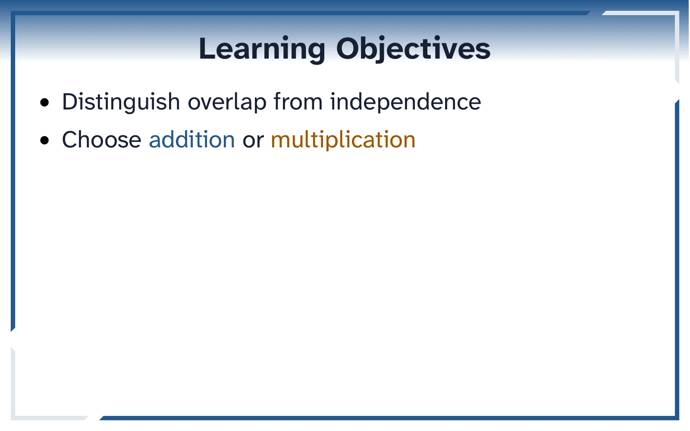
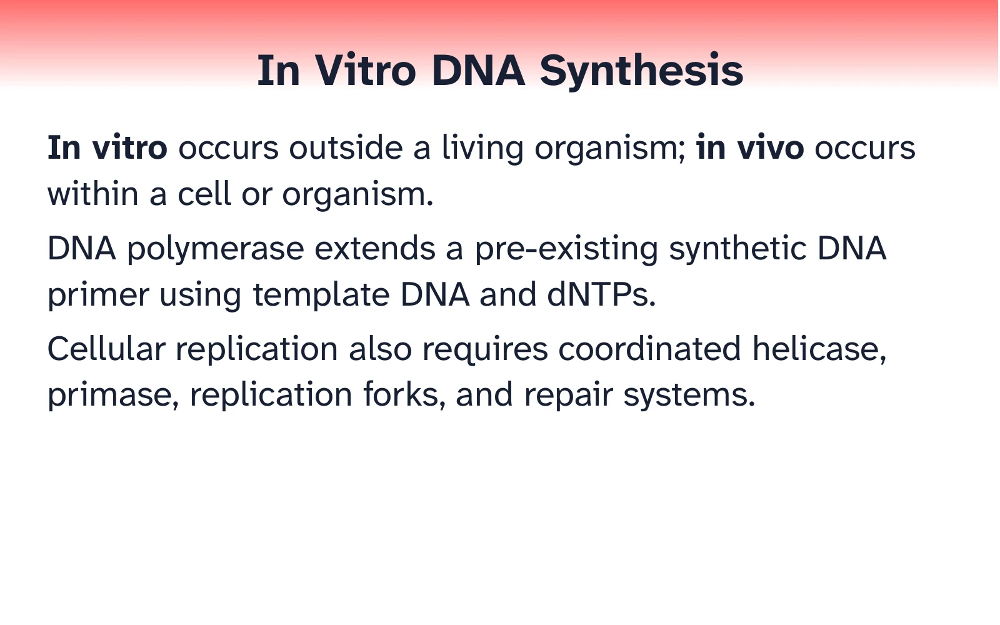
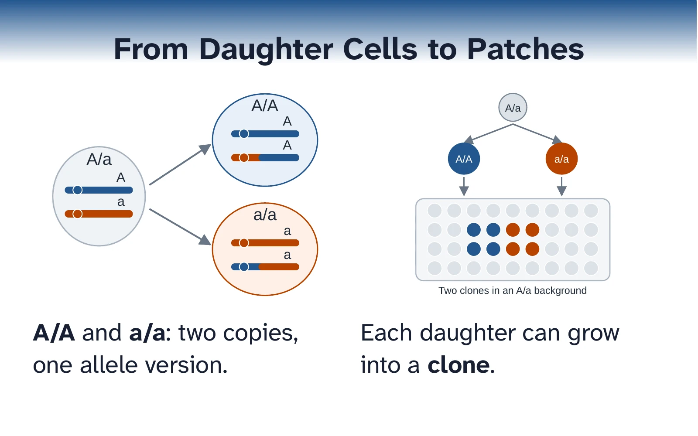
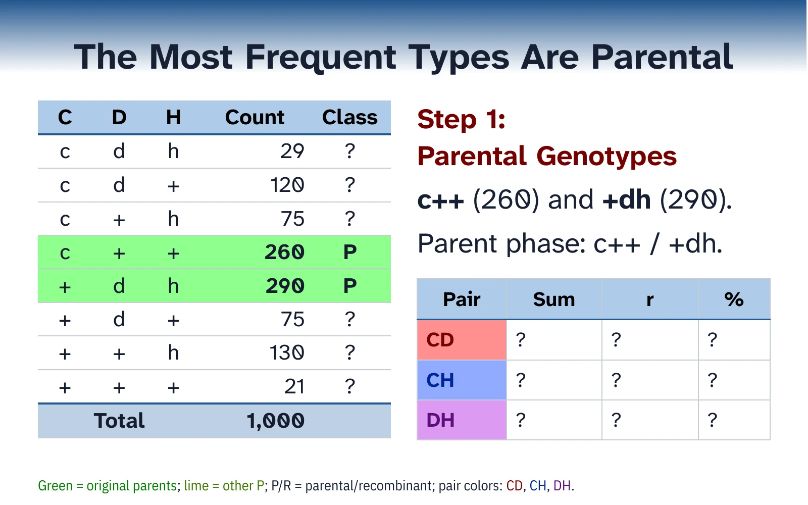
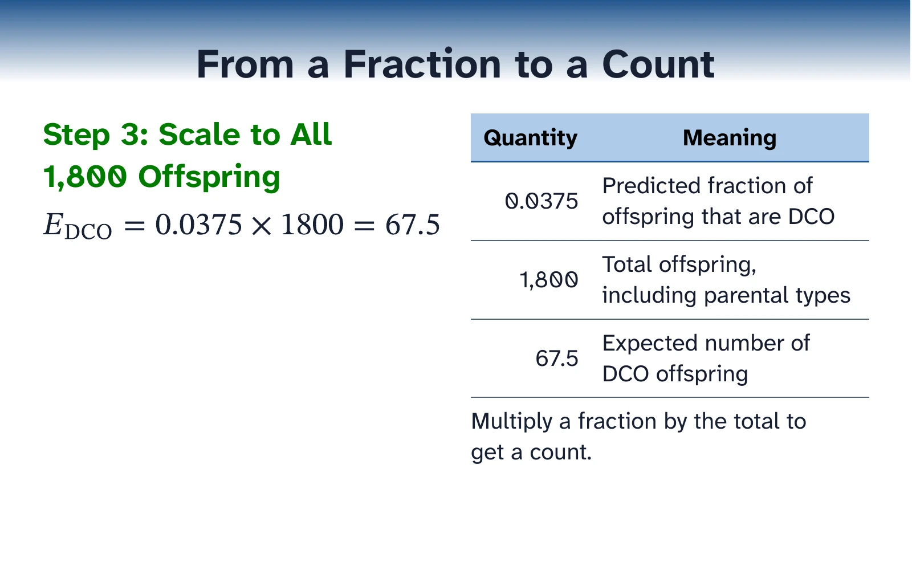
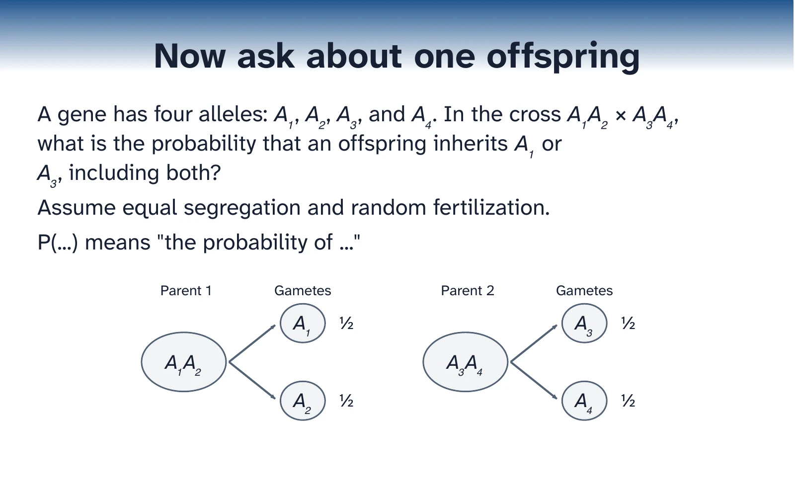
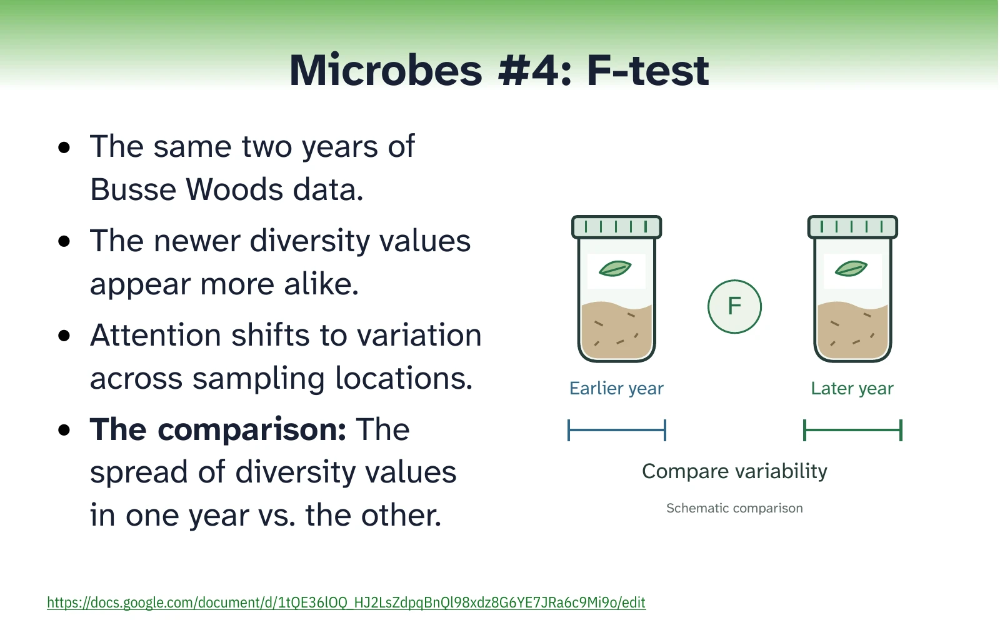
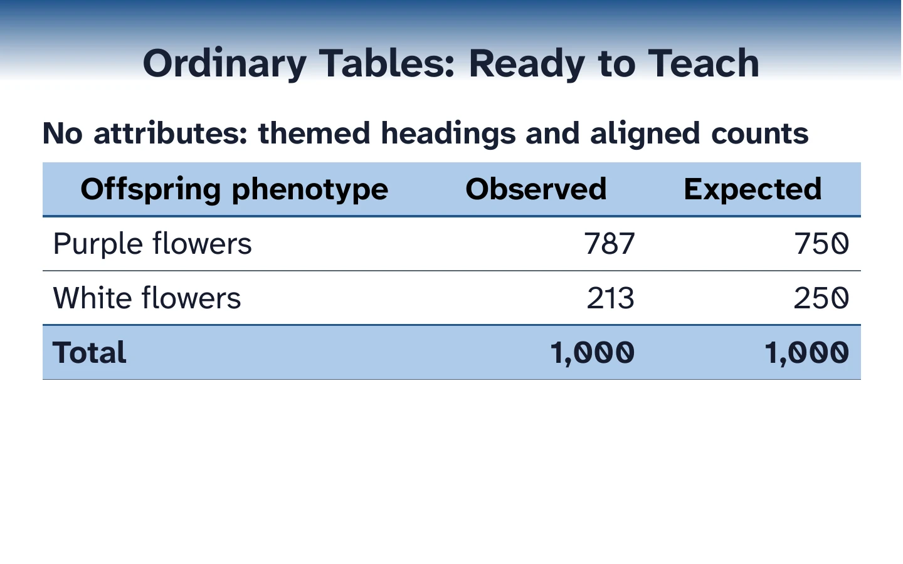

# Curated teaching-slide exemplars

Start with a teaching task, then borrow a complete pattern. These seven short decks contain lightly
polished copies of instructor coursework from Genetics, Biotechnology, and Biostatistics. They
retain the examples' scientific context and course themes so you can see why a layout serves its
lesson.

The collection has 68 authored slides, including one hidden optional slide, and 67 visible slides
for normal PDF export. Slide numbers below mean authored order in the Djot and ODP, starting at 1.
Each numbered slide link opens its Djot source definition; PDF page numbers are listed separately. Source
physical-slide numbers refer to original Djot layout definitions, excluding shared include
expansion. The historical covers and October 21, 2026 announcements are examples of course identity
and logistics, not current dates or promises.

## Choose a teaching task

Click a gallery image or its source link to open the Djot deck. Seven maintained previews show
the teaching-purpose decks; the table demonstration reuses its authoring-guide screenshot.

| Orientation and boundaries | Text and notation |
| --- | --- |
| [](exemplar_01_orientation.djot) | [](exemplar_02_text_explanations.djot) |
| [Djot source](exemplar_01_orientation.djot) &middot; [Pattern notes](#01-orientation) | [Djot source](exemplar_02_text_explanations.djot) &middot; [Pattern notes](#02-text-explanations) |
| Learning objectives in a native bookend layout. | Readable prose with selective scientific emphasis. |

| Figures and comparisons | Data and working tables |
| --- | --- |
| [](exemplar_03_figures_comparisons.djot) | [](exemplar_04_data_tables.djot) |
| [Djot source](exemplar_03_figures_comparisons.djot) &middot; [Pattern notes](#03-figures-and-comparisons) | [Djot source](exemplar_04_data_tables.djot) &middot; [Pattern notes](#04-data-tables) |
| Two diagrams with short native captions. | Stable data, meaningful highlights, and a working answer table. |

| Equations and worked examples | Questions and sequences |
| --- | --- |
| [](exemplar_05_equations_worked_examples.djot) | [](exemplar_06_questions_sequences.djot) |
| [Djot source](exemplar_05_equations_worked_examples.djot) &middot; [Pattern notes](#05-equations-and-worked-examples) | [Djot source](exemplar_06_questions_sequences.djot) &middot; [Pattern notes](#06-questions-and-sequences) |
| A calculation beside its quantities and units. | A complete prompt with assumptions and a supporting diagram. |

| Logistics and study support | Native table styles |
| --- | --- |
| [](exemplar_07_logistics_study_support.djot) | [](table_styles.djot) |
| [Djot source](exemplar_07_logistics_study_support.djot) &middot; [Pattern notes](#07-logistics-and-study-support) | [Djot source](table_styles.djot) &middot; [Authoring guide](../docs/slide-specs/TABLE_AUTHORING_GUIDE.md) |
| A tutorial reminder with an original illustration and visible resource link. | The complete demonstration of table presets and local formatting. |

Deck counts and themes:

| Deck source | Theme | Authored / visible | Teaching purpose |
| --- | --- | --- | --- |
| [exemplar_01_orientation.djot](exemplar_01_orientation.djot) | Genetics | 11 / 11 | Frame a topic and mark its boundaries. |
| [exemplar_02_text_explanations.djot](exemplar_02_text_explanations.djot) | Biotechnology | 8 / 8 | Explain mechanisms with readable prose and notation. |
| [exemplar_03_figures_comparisons.djot](exemplar_03_figures_comparisons.djot) | Genetics | 10 / 10 | Choose figure size, labels, captions, and comparison. |
| [exemplar_04_data_tables.djot](exemplar_04_data_tables.djot) | Genetics | 10 / 10 | Keep data visible while interpretation develops. |
| [exemplar_05_equations_worked_examples.djot](exemplar_05_equations_worked_examples.djot) | Genetics | 12 / 12 | Connect a complete problem to calculations and units. |
| [exemplar_06_questions_sequences.djot](exemplar_06_questions_sequences.djot) | Genetics | 7 / 7 | Ask, expose a shortcut, test, explain, and generalize. |
| [exemplar_07_logistics_study_support.djot](exemplar_07_logistics_study_support.djot) | Biostatistics | 10 / 9 | Connect agendas, schedules, resources, and study support. |

Use the explanations below as authoring references, not as permission to change the science or
invent new course policy. Keep a whole question, its assumptions, and its answer together. Keep
delivery cues in `@notes`; source credits and design rationale belong in this index. For full
syntax, use [DJOT_SLIDE_SYNTAX.md](../docs/slide-specs/DJOT_SLIDE_SYNTAX.md); for teaching
decisions, use [PEDAGOGY_GUIDE.md](../docs/slide-specs/PEDAGOGY_GUIDE.md).

Local readability polish darkens selected text foregrounds in decks 01, 03, 04, and 06 and in the
two copied Microbes SVGs for deck 07. The measured text/surface pairs meet the house 5.5:1 contrast
target while retaining their hues and semantic background fills. Original course files are
unchanged. This is source/compiled contrast evidence, separate from rendered review.

## Matching questions

Copy [matching_questions.djot](matching_questions.djot) for an instructor-approved matching
question/answer pair from Genetics Lecture 10B, slides 38-39. This standalone two-slide example
supplements the seven decks above; it requires no picture assets.

- Question: full descriptions in a native table, blank answer cells, and a visible term bank.
- Answer: repeat each full description in the same row order, with its matched term alongside.
- Carry each term's color from the bank into the answer; written labels carry the meaning too.
- Keep both slides together so students can compare their choices with complete visible matches.

The instructor approved this pair as an exemplar on November 10, 2026. The source is
[lect10b-karyotypes.djot](../genetics/LECT10/djot/lect10b-karyotypes.djot), headed
"Your Turn: Chromosome Shapes" and "Chromosome Shapes: Answer". Wording, colors, and layouts
are copied unchanged. Use the pattern for brief term-description matching; adapt the content
and review the rendered pair for longer entries.

## Build and adapt

Run from the repository root after the setup in [INSTALL.md](../docs/INSTALL.md). Lint one deck,
build its editable ODP and PDF, or build the whole collection with the existing folder command:

```bash
source source_me.sh && python3 deck_tools.py lint exemplars/exemplar_04_data_tables.djot
source source_me.sh && python3 deck_tools.py build exemplars/exemplar_04_data_tables.djot --format all
./build_slides.sh exemplars
```

On this macOS host, run every build/export command outside the agent sandbox. A build writes normal local delivery artifacts such as
`output/odp/exemplar_04_data_tables.odp` and `output/pdf/exemplar_04_data_tables.pdf`. The same stem
rule applies to all seven decks; these ignored output files are not GitHub download links. Open the
ODP in Impress for native editing, and use the PDF for static distribution.

To adapt a deck, copy its Djot file together with the matching `assets/<deckstem>/` subfolder,
preserving their relative paths. Text-only decks 01, 02, and 05 need no picture files. The
collection owns all its picture copies and has no runtime picture dependency on course folders,
private configuration, or live fetching. It remains a repository example: the engine, fonts, and
shared OTP template are required by the normal pipeline. If you move the copy or rename its asset
folder, update the image paths and lint again.

Refresh historical dates, destinations, classroom details, and policy statements before reuse.
Static previews and PDF answer states do not establish click playback in Impress. See
[AUTHORING_GUIDE.md](../docs/slide-specs/AUTHORING_GUIDE.md) for native editability and review
boundaries, and [USAGE.md](../docs/USAGE.md) for the complete command reference.

## 01: orientation

Source key (archive paths preserve identity if course folders move):

- **A:** [lect05d-v2-probability_concepts.djot](../genetics/LECT05/djot/lect05d-v2-probability_concepts.djot); `genetics/LECT05/djot/lect05d-v2-probability_concepts.djot`.
- **B:** [lect05d-probability_concepts.djot](../genetics/LECT05/djot/lect05d-probability_concepts.djot); `genetics/LECT05/djot/lect05d-probability_concepts.djot`.

### Course cover

Authored slides: [1](exemplar_01_orientation.djot#L3). PDF: 1.

Lecture, topic, chapter, instructor and date stay on separate readable lines. Alternative: Omit
chapter metadata when the chapter is unknown.

Source: A: "Lecture 05D" (physical slide 1).

Adaptation: Original cover metadata preserved; shortened notes omitted because the full lecture
story is outside this sample.

### Framed learning objectives

Authored slides: [2](exemplar_01_orientation.djot#L12). PDF: 2.

Two visible tasks match the two probability rules shown later. Alternative: Use a plain prompt when
starting a short activity rather than a whole topic.

Source: B: "Learning Objectives" (physical slide 2).

Adaptation: Retained first two objectives; omitted offspring and conditional-probability tasks
absent from this short sequence; changed one-panel to bookend.

### Framed definitions

Authored slides: [3](exemplar_01_orientation.djot#L21). PDF: 3.

Contrasting terms are defined before students choose a probability rule. Alternative: Use a diagram
when the spatial overlap itself is the teaching task.

Source: A: "Probability speak" (physical slide 3).

Adaptation: Selected five condition definitions from the right panel; rendered as native
term-definition entries; no scientific rewording.

### Decision roadmap

Authored slides: [4](exemplar_01_orientation.djot#L38). PDF: 4.

Names the event before selecting a rule and retains conditions and a biology check. Alternative: Use
a numbered algorithm when every step must occur in strict order.

Source: A: "Summary: context before calculation" (physical slide 43).

Adaptation: Moved the original recap into an opening decision aid; normalized title case; supplied
delivery notes.

### Major/minor dividers with rule references

Authored slides: [5](exemplar_01_orientation.djot#L55), [6](exemplar_01_orientation.djot#L59), [7](exemplar_01_orientation.djot#L65), [8](exemplar_01_orientation.djot#L83), [9](exemplar_01_orientation.djot#L89). PDF: 5, 6, 7, 8, 9.

One major boundary holds two clearly named tools; blue OR and orange AND persist through rule and
summary. Alternative: Skip dividers for a single-slide insert; use figures and worked examples when
teaching these rules for the first time.

Source: A: "Probability in crosses" (physical slide 4); A: "Addition Rule" (physical slide 7); B: "[Addition Rules]{color=blue}" (physical slide 32); B: "[Multiplication Rules]{color=orange}" (physical slide 31); A: "Probability speak" (physical slide 3).

Adaptation: Major divider renamed Probability Rules; source section pattern used as subsection; rule
titles normalized; event letters standardized to B and C with source explanation; general
multiplication shown once as P(B) times P(C|B), omitting redundant reversed equality; conditional
notation visibly defined from the original lecture.

### Framed recap

Authored slides: [10](exemplar_01_orientation.djot#L107). PDF: 10.

The two rule colors and their conditions return in a compact usable recap. Alternative: Retain full
rule cards as well when students need an offline formula reference.

Source: B: "Summary: check the rule's condition" (physical slide 33).

Adaptation: Selected OR, AND and given bullets; omitted successful-gamete detail outside this
sample; changed layout to bookend and title to Key Takeaways.

### Course closer

Authored slides: [11](exemplar_01_orientation.djot#L117). PDF: 11.

The familiar course-themed closer gives a clear stopping point. Alternative: Omit an artificial
closer on a short excerpt intended to continue into another deck.

Source: A: "THE END" (physical slide 44).

Adaptation: Preserved closer and final-questions speaking cue.

## 02: text explanations

Source key (archive paths preserve identity if course folders move):

- **A:** [lect03c-talking_points_set_2.djot](../biotech/LECT03/djot/lect03c-talking_points_set_2.djot); `biotech/LECT03/djot/lect03c-talking_points_set_2.djot`.
- **B:** [lect02d-dna_structure_overview.djot](../genetics/LECT02/djot/lect02d-dna_structure_overview.djot); `genetics/LECT02/djot/lect02d-dna_structure_overview.djot`.

### Paragraphs, selective emphasis and list contrast

Authored slides: [1](exemplar_02_text_explanations.djot#L3), [2](exemplar_02_text_explanations.djot#L16). PDF: 1, 2.

Three short paragraphs establish a contrast; a complete reagent sentence precedes two clear
implications. Alternative: Use a diagram for the physical replication mechanism or a table for a
larger method comparison.

Source: A: "Answers: In Vitro DNA Synthesis" (physical slide 42); A: "Answers: In Vitro DNA Synthesis - What a reaction needs" (physical slide 43).

Adaptation: Source prose preserved; first slide list markers removed to show coherent paragraphs;
reaction reagent sentence made a paragraph; small emphasis distinguishes in vitro and in vivo;
titles shortened.

### Prime notation and fixed-width DNA

Authored slides: [3](exemplar_02_text_explanations.djot#L29), [4](exemplar_02_text_explanations.djot#L41). PDF: 3, 4.

A visible end-direction statement immediately precedes a complete sequence question and its native
answer. Alternative: Use a labeled strand diagram when teaching strand orientation before the
learner has encountered antiparallel DNA.

Source: B: "Nucleotides join to forma DNA or an RNA chain" (physical slide 16); B: "Untitled multiple-choice question 3: ATGC with prime ends" (physical slide 32).

Adaptation: Extracted the complete text statement into a text-only slide without the source figure
of unverified ownership; added descriptive title and delivery cue; kept all five MC choices and
answer including antiparallel complementary strand; corrected complimentary to complementary and
removed the source question number.

### Readable list hierarchy

Authored slides: [5](exemplar_02_text_explanations.djot#L59), [6](exemplar_02_text_explanations.djot#L72). PDF: 5, 6.

One nested example explains a broad capability; a separate top-level item states the length
limitation. Alternative: Use equal-level bullets when all points are peers, or a process diagram to
show chemical steps.

Source: A: "Answers: Chemical DNA Synthesis" (physical slide 46); A: "Answers: Chemical DNA Synthesis - Strengths and limits" (physical slide 47).

Adaptation: Preserved source prose; selected emphasis on custom products; second strengths bullet
nested as an example of deliberate sequence design; titles shortened and normalized.

### Mechanism explanation at readable density

Authored slides: [7](exemplar_02_text_explanations.djot#L84), [8](exemplar_02_text_explanations.djot#L97). PDF: 7, 8.

The first slide names the method and components; the second keeps cycle stages and specificity
linked in full sentences. Alternative: Use a stable diagram sequence when the task is to trace
amplification over cycles.

Source: A: "Answers: PCR" (physical slide 50); A: "Answers: PCR - Cycle and specificity" (physical slide 51).

Adaptation: Source prose preserved; selective emphasis marks the cycle stages and specificity
condition; titles shortened.

## 03: figures and comparisons

The two original mitotic diagrams first appear with explanations, then together as an image
comparison. The later gene-mapping sequence moves from quantitative bars to choices, a large answer
diagram, a proportional map, and a table-based conclusion. Compare these layouts before choosing a
gallery: each panel here serves a specific comparison.

Source key (archive paths preserve identity if course folders move):

- **A:** [lect09d-yeast_unordered_tetrads.djot](../genetics/LECT09/djot/lect09d-yeast_unordered_tetrads.djot); `genetics/LECT09/djot/lect09d-yeast_unordered_tetrads.djot`.
- **B:** [lect09c-mitotic_crossover.djot](../genetics/LECT09/djot/lect09c-mitotic_crossover.djot); `genetics/LECT09/djot/lect09c-mitotic_crossover.djot`.
- **C:** [lect08f-three_point_testcross_bpw.djot](../genetics/LECT08/djot/lect08f-three_point_testcross_bpw.djot); `genetics/LECT08/djot/lect08f-three_point_testcross_bpw.djot`.

### Figure with explanation

Authored slides: [1](exemplar_03_figures_comparisons.djot#L3). PDF: 1.

One labeled ascus anchors the biological definition. Alternative: Use a large figure when the labels
need more space.

Source: A: "All Four Products Stay Together" (physical slide 6).

Adaptation: Copied complete slide; local asset references replace course-relative paths; intervening
shared roadmap include omitted.

### One artwork with associated labels

Authored slides: [2](exemplar_03_figures_comparisons.djot#L21). PDF: 2.

The same ascus supports the reason for retaining all four products. Alternative: Use a gallery only
when several different objects need comparison.

Source: A: "Why Keep the Four Products Together?" (physical slide 14).

Adaptation: Copied complete slide; local asset references replace course-relative paths; intervening
shared roadmap include omitted.

### Concept diagram beside explanation

Authored slides: [3](exemplar_03_figures_comparisons.djot#L45). PDF: 3.

The diagram keeps chromosome copy number separate from allele identity. Alternative: Use a sequence
when replication and segregation intermediates matter.

Source: B: "Two Copies of the Same Allele" (physical slide 12).

Adaptation: Speaker notes make the omitted replication and four-chromatid intermediate explicit;
they retain the alternate-segregation and other-mechanism qualifications. Artwork and teaching
text are copied with local asset paths, and the intervening shared roadmap include is omitted.

### Lineage diagram beside explanation

Authored slides: [4](exemplar_03_figures_comparisons.djot#L68). PDF: 4.

A repeated color connects daughter cells to neighboring clones. Alternative: Use measured data when
comparing actual growth rates.

Source: B: "One Event Can Make a Patch" (physical slide 10).

Adaptation: Copied complete slide; local asset references replace course-relative paths; intervening
shared roadmap include omitted.

### Image comparison: genotype change to visible clone

Authored slides: [5](exemplar_03_figures_comparisons.djot#L88). PDF: 5.

Equal image slots connect a cellular genotype outcome to its tissue-scale consequence; captions
remain native. Alternative: Use separate slides when the class needs to trace chromosome copies or
individual lineages first.

Source: B: "One Event Can Make a Patch" (physical slide 10).

Also uses the source heading "Two Copies of the Same Allele" from the same deck.

Display pattern: [SVG_DIAGRAMS.md](../docs/slide-specs/SVG_DIAGRAMS.md); Comparison layout.

Adaptation: Copied complete slide; local asset references replace course-relative paths; intervening
shared roadmap include omitted. Image-comparison rearranges the two preceding original diagrams and
native captions. The comparison captions are shortened to subordinate labels so the owned figures
receive more space; the full genotype and clone explanations remain on slides 3-4.

### Large quantitative figure with native prompt

Authored slides: [6](exemplar_03_figures_comparisons.djot#L108). PDF: 6.

Bars share an origin and scale, making the largest pair easy to compare. Alternative: Use a native
table for exact lookup rather than magnitude comparison.

Source: C: "What Is the Gene Order?" (physical slide 35).

Adaptation: Copied complete slide; local asset references replace course-relative paths; intervening
shared roadmap include omitted.

### Comparison table with explanatory prompt

Authored slides: [7](exemplar_03_figures_comparisons.djot#L118). PDF: 7.

Reversed orders sit beside each other so equivalence is explicit. Alternative: Use a chromosome
figure to emphasize physical intervals.

Source: C: "Three Choices, One Middle Gene" (physical slide 36).

Adaptation: Copied complete slide; local asset references replace course-relative paths; intervening
shared roadmap include omitted.

### Large labeled artwork with native caption

Authored slides: [8](exemplar_03_figures_comparisons.djot#L136). PDF: 8.

The equivalent reversed order reinforces that orientation is arbitrary. Alternative: Use the
three-choice table before the answer is known.

Source: C: "Place the Middle Gene" (physical slide 37).

Display pattern: [DJOT_SLIDE_SYNTAX.md](../docs/slide-specs/DJOT_SLIDE_SYNTAX.md); big-image.

Adaptation: Copied complete slide; local asset references replace course-relative paths; intervening
shared roadmap include omitted. Existing big-image display pattern gives the original diagram a full
image region; native caption states the equivalent order already present in the diagram. Original
heading moves into caption meaning.

### Proportional map with native question

Authored slides: [9](exemplar_03_figures_comparisons.djot#L146). PDF: 9.

The 30:20 geometry distinguishes mapped intervals from observed outer-pair recombination.
Alternative: Use the preceding bar chart when comparing measured percentages.

Source: C: "Why Don't the Results Add?" (physical slide 38).

Adaptation: Copied complete slide; local asset references replace course-relative paths; intervening
shared roadmap include omitted.

### Table-to-conclusion explanation

Authored slides: [10](exemplar_03_figures_comparisons.djot#L156). PDF: 10.

Two offspring classes connect the map discrepancy to double recombinants. Alternative: Use the
crossover diagram if the allele exchange itself is unfamiliar.

Source: C: "Count Both Adjacent Intervals" (physical slide 42).

Adaptation: Copied complete slide; local asset references replace course-relative paths; intervening
shared roadmap include omitted.

## 04: data tables

The test-cross sequence keeps the raw data and working answer fields visible through classification
and calculation; its completed summary resolves the opening task. The final page shows a different
task, choosing a minimum in a lower-triangle distance matrix. For preset and formatting coverage,
the canonical 14-page [table_styles.djot](table_styles.djot) remains the full demonstration; see
[TABLE_AUTHORING_GUIDE.md](../docs/slide-specs/TABLE_AUTHORING_GUIDE.md).

Source key (archive paths preserve identity if course folders move):

- **A:** [lect08f-three_point_testcross_bpw.djot](../genetics/LECT08/djot/lect08f-three_point_testcross_bpw.djot); `genetics/LECT08/djot/lect08f-three_point_testcross_bpw.djot`.
- **B:** [lect12c_more_gene_trees_part_01.djot](../genetics/LECT12/djot/lect12c_more_gene_trees_part_01.djot); `genetics/LECT12/djot/lect12c_more_gene_trees_part_01.djot`.

### Context for interpreting data

Authored slides: [1](exemplar_04_data_tables.djot#L3). PDF: 1.

The tester and fictional trait definitions explain what each offspring count measures. Alternative:
Use a definitions slide when the gene notation is already familiar.

Source: A: "&#x1FAB0; Fruit Fly Inheritance" (physical slide 3).

Adaptation: Copied complete slide; local asset references replace course-relative paths; intervening
shared roadmap include omitted.

### Full data with aligned values and progress table

Authored slides: [2](exemplar_04_data_tables.djot#L24). PDF: 2.

The complete counts stay visible beside the task and unfinished result fields. Alternative: Use a
compact summary once raw-class interpretation is finished.

Source: A: "Three-Point Test-Cross Data" (physical slide 5).

Adaptation: Copied complete slide; local asset references replace course-relative paths; intervening
shared roadmap include omitted.

### Meaningful scientific fills

Authored slides: [3](exemplar_04_data_tables.djot#L58). PDF: 3.

Green rows preserve parental references without deleting other observations. Alternative: Use an
uncolored question state before revealing the parents.

Source: A: "The Most Frequent Types Are Parental" (physical slide 8).

Adaptation: Copied complete slide; local asset references replace course-relative paths; intervening
shared roadmap include omitted.

### Focused data with a covered variable

Authored slides: [4](exemplar_04_data_tables.djot#L98). PDF: 4.

Gray removes the third locus from this pairwise decision while retaining row positions. Alternative:
Use all three gene columns when determining phase or gene order.

Source: A: "C to D Distance: Which Numbers to Add?" (physical slide 10).

Adaptation: Copied complete slide; local asset references replace course-relative paths; intervening
shared roadmap include omitted.

### Classification with redundant labels

Authored slides: [5](exemplar_04_data_tables.djot#L138). PDF: 5.

P/R labels and colors distinguish original parents, other parental pairs, and recombinants.
Alternative: Use the preceding question state for an unprompted classification.

Source: A: "Parental and Recombinant C-D Types" (physical slide 13).

Adaptation: Copied complete slide; local asset references replace course-relative paths; intervening
shared roadmap include omitted.

### Stable working table: sum

Authored slides: [6](exemplar_04_data_tables.djot#L178). PDF: 6.

Fixed rows connect the four highlighted counts to their sum. Alternative: Use a single summary row
after students can identify the counts.

Source: A: "C to D Distance: Sum Recombinant Counts" (physical slide 15).

Adaptation: Copied complete slide; local asset references replace course-relative paths; intervening
shared roadmap include omitted.

### Stable working table: fraction

Authored slides: [7](exemplar_04_data_tables.djot#L216). PDF: 7.

The result appears in the same progress-table position while the data stay fixed. Alternative:
Combine steps only when the class no longer needs the intermediate fraction.

Source: A: "C to D Distance: Divide by Total" (physical slide 16).

Adaptation: Copied complete slide; local asset references replace course-relative paths; intervening
shared roadmap include omitted.

### Stable working table: percent

Authored slides: [8](exemplar_04_data_tables.djot#L254). PDF: 8.

The fraction and percentage remain distinct, with the pair color carried into the answer.
Alternative: Keep the fraction when a downstream calculation requires r.

Source: A: "C to D Distance: Convert to Percent" (physical slide 17).

Adaptation: Copied complete slide; local asset references replace course-relative paths; intervening
shared roadmap include omitted.

### Completed data summary with map

Authored slides: [9](exemplar_04_data_tables.djot#L292). PDF: 9.

All three pairwise answer fields resolve the opening task, with percent and map distance
distinguished. Alternative: Retain the full raw table when students still need to check row
classifications.

Source: A: "Complete the Answer Fields" (physical slide 43).

Adaptation: Copied complete slide; local asset references replace course-relative paths; intervening
shared roadmap include omitted.

### Native lower-triangle distance matrix

Authored slides: [10](exemplar_04_data_tables.djot#L314). PDF: 10.

Labeled axes, suppressed duplicate triangle and one highlighted minimum focus the first merge
decision. Alternative: Use a full symmetric matrix when teaching why the two halves contain
duplicate information.

Source: B: "*Find smallest value*" (physical slide 9).

Adaptation: Copied complete slide; local asset references replace course-relative paths; intervening
shared roadmap include omitted.

## 05: equations and worked examples

Source archive path: `genetics/LECT09/djot/lect09b1-interference_worked_example.djot`
([lect09b1-interference_worked_example.djot](../genetics/LECT09/djot/lect09b1-interference_worked_example.djot)).
Original headings are retained in the stage table below; each stage links to its Djot source. Read this as a
connected sequence, rather than a set of interchangeable formula or question slides.

Use slides 1-5 to establish the complete test-cross problem and identify the observed doubles;
slides 6-12 carry the same problem through probability, expected count, coincidence, interference,
and denominator interpretation. The repeated genotype/count table keeps row positions stable while
highlights change. Choose a shorter single-step example when prerequisites are missing, retaining
its full problem and assumptions.

Adaptation: the compact workspace removes the redundant phenotype column while slide 1 retains the
trait meanings. Vertical table padding is reduced; slide 7 places its unchanged
independence-qualified equation and all three explanatory bullets in one full-width panel; the other
math sits beside its original explanation. The observed count appears in its heading, and short
source-grounded DCO/CoC definitions support the
excerpt. Keep all eight genotype/count associations, units, and the distinct denominators when
adapting.

| Authored source slide | PDF page | Stage and why it works | Original source heading |
| --- | --- | --- | --- |
| [1](exemplar_05_equations_worked_examples.djot#L3) | 1 | **Problem setup:** Names the phenotype meanings and the tester before numbers. | Fruit Fly Test Cross |
| [2](exemplar_05_equations_worked_examples.djot#L19) | 2 | **Given map:** Separates map order from alphabetical allele columns. | The Gene Order Is Given |
| [3](exemplar_05_equations_worked_examples.djot#L37) | 3 | **Full problem workspace:** Retains all eight genotype/count associations in a native table. | Calculate the Interference |
| [4](exemplar_05_equations_worked_examples.djot#L60) | 4 | **Comparison:** Pairs each parent with its double crossover; only W changes. | Only the Middle Gene Changes |
| [5](exemplar_05_equations_worked_examples.djot#L79) | 5 | **Observed count:** Highlights both double-crossover counts without moving rows. | Count the Observed Doubles |
| [6](exemplar_05_equations_worked_examples.djot#L102) | 6 | **Percent conversion:** Shows percent-to-probability before multiplication. | Convert Percent to Probability |
| [7](exemplar_05_equations_worked_examples.djot#L118) | 7 | **Full-width equation and explanation:** Connects the product to independence, not merely arithmetic. | Why Multiply the Probabilities? |
| [8](exemplar_05_equations_worked_examples.djot#L134) | 8 | **Fraction to count:** Explains each input and the expected-count units. | From a Fraction to a Count |
| [9](exemplar_05_equations_worked_examples.djot#L157) | 9 | **Model interpretation:** Explains why an expected count can be non-integer. | Why Is the Expected Count 67.5? |
| [10](exemplar_05_equations_worked_examples.djot#L169) | 10 | **Ratio and units:** Counts cancel, making coincidence dimensionless. | Calculate Coincidence |
| [11](exemplar_05_equations_worked_examples.djot#L187) | 11 | **Complement:** Interference is the missing fraction of independent expectation. | Calculate Interference |
| [12](exemplar_05_equations_worked_examples.djot#L205) | 12 | **Denominator comparison:** Distinguishes DCO percent, coincidence, and interference. | What Does the 20% Refer To? |

## 06: questions and sequences

Source archive path: `genetics/LECT05/djot/lect05d-v2-probability_concepts.djot`
([lect05d-v2-probability_concepts.djot](../genetics/LECT05/djot/lect05d-v2-probability_concepts.djot)).
Original headings are retained in the stage table below; each stage links to its Djot source. Read this as a
connected sequence, rather than a set of interchangeable formula or question slides.

Use the full seven-slide arc to challenge a plausible shortcut before presenting the rule. The
visual prompt and native multiple-choice feedback lead into a four-cell Punnett question/answer
workspace with stable positions, then correction, generalization, and overlap calculation. Choose a
simpler complete cross when students lack the prerequisites; do not retain only the answer.

Adaptation: the original SVG replaces its PNG render; the native answer popup condenses existing
feedback to "B. &frac34;: three outcomes." and "Overlap was counted twice." to fit its region; the general rule is native text without the uncertain Venn artwork. The final table/prose
uses one panel, and probability notation and mutually exclusive events are defined locally. The PDF
provides a static answer state; attended click playback remains a separate check.

| Authored source slide | PDF page | Stage and why it works | Original source heading |
| --- | --- | --- | --- |
| [1](exemplar_06_questions_sequences.djot#L3) | 1 | **Full visual prompt:** Shows parent-to-gamete relationships and states assumptions. | Now ask about one offspring |
| [2](exemplar_06_questions_sequences.djot#L30) | 2 | **Multiple-choice reveal:** Preserves the tempting shortcut and gives feedback on click. | Does every offspring qualify? |
| [3](exemplar_06_questions_sequences.djot#L64) | 3 | **Question workspace:** Students complete the same four-cell native Punnett table. | Test the claim with a Punnett square |
| [4](exemplar_06_questions_sequences.djot#L89) | 4 | **Answer workspace:** Same positions and table-group show three qualifying outcomes. | Three of the four offspring types qualify |
| [5](exemplar_06_questions_sequences.djot#L113) | 5 | **Progressive explanation:** Labels the shared cell and corrects the double count. | Adding counted the shared cell twice |
| [6](exemplar_06_questions_sequences.djot#L139) | 6 | **Generalization:** Names events and states the general addition rule after the example. | [Rule card: general addition]{color=blue} |
| [7](exemplar_06_questions_sequences.djot#L163) | 7 | **Return to the shared cell:** Calculates the overlap using the same offspring and assumptions. | Calculate the probability of that shared cell |

## 07: logistics and study support

All source pages come from the historical October 21, 2026 Biostatistics announcements. Slides 1-8
map to PDF pages 1-8; slide 9 is hidden and has a diagnostic preview only; authored slide 10 is
normal PDF page 9. Tutorial drawings are illustrative memory cues, not measured results.

Source key (archive paths preserve identity if course folders move):

- **A:** [lect08a-2026_biostats_announcements.djot](../biostats/LECT08/djot/lect08a-2026_biostats_announcements.djot); `biostats/LECT08/djot/lect08a-2026_biostats_announcements.djot`.

### Historical course identity

Authored slides: [1](exemplar_07_logistics_study_support.djot#L3). PDF: 1.

Actual lecture/date identifies the historical announcements. Alternative: A new cover when adapting
to another term.

Source: A: "Lecture 08A" (physical slide 1).

Adaptation: Verbatim copy; dates and promises not refreshed

### Agenda

Authored slides: [2](exemplar_07_logistics_study_support.djot#L11). PDF: 2.

Topics, tutorial release, and meeting format appear together. Alternative: A roadmap for a
scientific procedure.

Source: A: "Today's Agenda" (physical slide 2).

Adaptation: Verbatim copy; dates and promises not refreshed

### Visible resource URLs

Authored slides: [3](exemplar_07_logistics_study_support.djot#L22). PDF: 3.

Complete URLs retain context without private configuration. Alternative: A shorter list when fewer
destinations are needed.

Source: A: "Important Course Links" (physical slide 10).

Adaptation: Verbatim copy; dates and promises not refreshed

### Current-week schedule

Authored slides: [4](exemplar_07_logistics_study_support.djot#L37). PDF: 4.

Meeting format, topic, due work, and graduate work stay distinguishable. Alternative: A table for
several weeks.

Source: A: "This Week: Oct 21" (physical slide 12).

Adaptation: Verbatim copy; dates and promises not refreshed

### Lookahead and instructor note

Authored slides: [5](exemplar_07_logistics_study_support.djot#L50). PDF: 5.

Asynchronous format and target release are explicit; note distinguishes target from guarantee.
Alternative: Refresh dates before using in a new term.

Source: A: "Next Week: Oct 28" (physical slide 13).

Adaptation: Verbatim copy; dates and promises not refreshed

### Assignment schedule table

Authored slides: [6](exemplar_07_logistics_study_support.djot#L66). PDF: 6.

Rows preserve assignment/date relationships; near-term rows are emphasized. Alternative: Separate
weekly slides for longer assignment labels.

Source: A: "Homework Due Dates (Part 2)" (physical slide 15).

Adaptation: Add table padding="4pt 18pt" to separate assignment and date columns; original
wording/colors/dates unchanged.

### Tutorial reminder with citation

Authored slides: [7](exemplar_07_logistics_study_support.djot#L82). PDF: 7.

Original schematic recalls the Busse Woods scenario; complete guide URL uses dedicated citation
footer. Alternative: A worked calculation when teaching the test.

Source: A: "Microbes #4: F-test" (physical slide 24).

Adaptation: Artwork copied to deck-owned folder; text foregrounds darkened for contrast, with
geometry, strokes, light fills, and teaching content retained.

### Study reference and instructor note

Authored slides: [8](exemplar_07_logistics_study_support.djot#L101). PDF: 8.

Study instructions stay visible; retry-policy caveat remains in speaker notes. Alternative: An
ordinary teaching slide for live discussion.

Source: A: "Working Through Tutorials" (physical slide 30).

Adaptation: one-panel changed to reference; original prose and note retained

### Optional hidden tutorial

Authored slides: [9](exemplar_07_logistics_study_support.djot#L117). PDF: hidden; no normal PDF page.

Next related comparison stays editable and retains its guide citation and local artwork.
Alternative: Set hidden false when ANOVA support is needed live.

Source: A: "Microbes #5: ANOVA" (physical slide 25).

Adaptation: hidden: true added; artwork copied locally; text foregrounds darkened for contrast,
with geometry, strokes, light fills, and teaching content retained.

### Closing

Authored slides: [10](exemplar_07_logistics_study_support.djot#L137). PDF: 9.

Preserves the original announcement closure. Alternative: Key takeaways for a content lecture.

Source: A: "THE END" (physical slide 32).

Adaptation: Verbatim copy; dates and promises not refreshed

## Local artwork credits

These are owned local copies of original teaching constructions, credited below by their source
archive paths and positive construction evidence. The `.drawn.svg` suffix alone is not ownership
evidence. Historical course links document provenance; no deck loads artwork through those links.
Sources, headings, and adaptations above credit the text and table selections as well.

- [assets/exemplar_03_figures_comparisons/homework_ascus.drawn.svg](assets/exemplar_03_figures_comparisons/homework_ascus.drawn.svg)
  - Original archive path: `genetics/LECT09/djot/assets/lect09_tetrad_concepts/homework_ascus.drawn.svg`.
  - Evidence: genetics/LECT09/djot/assets/lect09_tetrad_concepts/lect09d_figure_sources.json: homework_ascus.drawn.svg is constructed from original genemap_art/asci.py:ascus_svg, source hash and four genotypes recorded. No textbook component artwork.
- [assets/exemplar_03_figures_comparisons/loh_outcome.drawn.svg](assets/exemplar_03_figures_comparisons/loh_outcome.drawn.svg)
  - Original archive path: `genetics/LECT09/djot/assets/lect09c-mitotic_crossover/loh_outcome.drawn.svg`.
  - Evidence: genetics/LECT09/djot/LECT09C_RESEARCH.md Figures and reproducibility plus research_sources.json: original conceptual diagrams constructed for the research additions; native vector geometry, explicit simplifications and construction references, no imported research figures.
- [assets/exemplar_03_figures_comparisons/clonal_patches.drawn.svg](assets/exemplar_03_figures_comparisons/clonal_patches.drawn.svg)
  - Original archive path: `genetics/LECT09/djot/assets/lect09c-mitotic_crossover/clonal_patches.drawn.svg`.
  - Evidence: genetics/LECT09/djot/LECT09C_RESEARCH.md Figures and reproducibility plus research_sources.json: original conceptual diagrams constructed for the research additions; native vector geometry, explicit simplifications and construction references, no imported research figures.
- [assets/exemplar_03_figures_comparisons/pairwise_results.drawn.svg](assets/exemplar_03_figures_comparisons/pairwise_results.drawn.svg)
  - Original archive path: `genetics/LECT08/djot/assets/lect08f-three_point_testcross_bpw/pairwise_results.drawn.svg`.
  - Evidence: genetics/LECT08/djot/LECT08_REVIEW.md: fixed local BPW instance; instructor-accepted example; Sources informing the diagrams explicitly identifies conceptual references, not imported textbook figures. SVG has vector geometry/live text and no embedded or external image.
- [assets/exemplar_03_figures_comparisons/gene_order_middle.drawn.svg](assets/exemplar_03_figures_comparisons/gene_order_middle.drawn.svg)
  - Original archive path: `genetics/LECT08/djot/assets/lect08f-three_point_testcross_bpw/gene_order_middle.drawn.svg`.
  - Evidence: genetics/LECT08/djot/LECT08_REVIEW.md: fixed local BPW instance; instructor-accepted example; Sources informing the diagrams explicitly identifies conceptual references, not imported textbook figures. SVG has vector geometry/live text and no embedded or external image.
- [assets/exemplar_03_figures_comparisons/gene_map.drawn.svg](assets/exemplar_03_figures_comparisons/gene_map.drawn.svg)
  - Original archive path: `genetics/LECT08/djot/assets/lect08f-three_point_testcross_bpw/gene_map.drawn.svg`.
  - Evidence: genetics/LECT08/djot/LECT08_REVIEW.md: fixed local BPW instance; instructor-accepted example; Sources informing the diagrams explicitly identifies conceptual references, not imported textbook figures. SVG has vector geometry/live text and no embedded or external image.
- [assets/exemplar_04_data_tables/testcross.drawn.svg](assets/exemplar_04_data_tables/testcross.drawn.svg)
  - Original archive path: `genetics/LECT08/djot/assets/lect08f-three_point_testcross_bpw/testcross.drawn.svg`.
  - Evidence: genetics/LECT08/djot/LECT08_REVIEW.md: fixed local BPW instance; instructor-accepted example; Sources informing the diagrams explicitly identifies conceptual references, not imported textbook figures. SVG has vector geometry/live text and no embedded or external image.
- [assets/exemplar_04_data_tables/gene_map_summary.drawn.svg](assets/exemplar_04_data_tables/gene_map_summary.drawn.svg)
  - Original archive path: `genetics/LECT08/djot/assets/lect08f-three_point_testcross_bpw/gene_map_summary.drawn.svg`.
  - Evidence: genetics/LECT08/djot/LECT08_REVIEW.md: fixed local BPW instance; instructor-accepted example; Sources informing the diagrams explicitly identifies conceptual references, not imported textbook figures. SVG has vector geometry/live text and no embedded or external image.
- [assets/exemplar_06_questions_sequences/gamete_branches.drawn.svg](assets/exemplar_06_questions_sequences/gamete_branches.drawn.svg)
  - Original archive path: `genetics/LECT05/djot/assets/lect05d-v2-probability_concepts/gamete_branches.svg`.
  - Evidence: genetics/LECT05/djot/LECT05D_V2_REVIEW.md Graphics and evidence identifies this as one of three new editable schematic SVG sources, with construction derived from stated cross models and instructor original ODP/PDF slides 12-13. All paths, ellipses and editable labels; no embedded images or external resources. Local copy uses the .drawn.svg filename.
- [assets/exemplar_07_logistics_study_support/microbes_4.drawn.svg](assets/exemplar_07_logistics_study_support/microbes_4.drawn.svg)
  - Original archive path: `biostats/LECT08/djot/assets/tutorial_overviews/microbes_4.drawn.svg`.
  - Local adaptation: text fills darkened within their original hues; geometry, strokes, and light fills retained.
  - Evidence: docs/DESIGN_DECISIONS.md, Tutorial art and citation footer: 'Use original schematic SVGs ... for the eight biostats tutorial reminders'; Tutorial illustration identity refinements preserves marks and geometry.
- [assets/exemplar_07_logistics_study_support/microbes_5.drawn.svg](assets/exemplar_07_logistics_study_support/microbes_5.drawn.svg)
  - Original archive path: `biostats/LECT08/djot/assets/tutorial_overviews/microbes_5.drawn.svg`.
  - Local adaptation: text fills darkened within their original hues; geometry, strokes, and light fills retained.
  - Evidence: docs/DESIGN_DECISIONS.md, Tutorial art and citation footer: 'Use original schematic SVGs ... for the eight biostats tutorial reminders'; Tutorial illustration identity refinements preserves marks and geometry.

Ownership records:
[lect09d_figure_sources.json](../genetics/LECT09/djot/assets/lect09_tetrad_concepts/lect09d_figure_sources.json),
[LECT09C_RESEARCH.md](../genetics/LECT09/djot/LECT09C_RESEARCH.md),
[LECT08_REVIEW.md](../genetics/LECT08/djot/LECT08_REVIEW.md),
[LECT05D_V2_REVIEW.md](../genetics/LECT05/djot/LECT05D_V2_REVIEW.md), and
[DESIGN_DECISIONS.md](../docs/DESIGN_DECISIONS.md#tutorial-art-and-citation-footer). The source
records distinguish construction references from copied textbook artwork; the Microbes reminders
depict schematic story cues rather than actual samples or test output.
